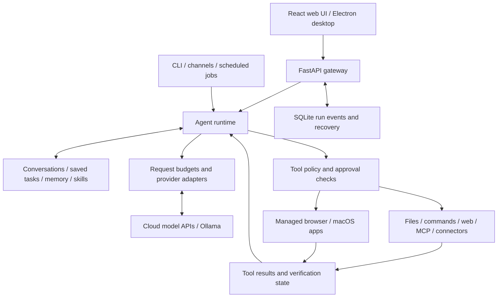

<p align="center">
  
</p>

<h1 align="center">RUNE</h1>

<p align="center"><strong>A local-first agent for code, documents, and everyday work.</strong></p>
<p align="center">Choose your model. Follow the work. Inspect the result.</p>

<p align="center">
  <a href="#quick-start">Quick Start</a> ·
  <a href="#architecture">Architecture</a> ·
  <a href="#design-decisions">Design</a> ·
  <a href="#validation">Validation</a> ·
  <a href="#what-rune-can-do">Features</a> ·
  <a href="#development">Development</a>
</p>

<p align="center">
  <a href="https://github.com/dybala-21/rune/actions/workflows/ci.yml"></a>
  
  <a href="LICENSE"></a>
</p>

<p align="center">
  
</p>

> Recorded from the current app using sample conversations. The coding example includes real local test output, and the browser is operated through the Computer panel. This is a UI walkthrough with shortened pauses, not a live-model run or a speed benchmark.

## Architecture

RUNE puts model calls, tool execution, approvals, and result checks in a shared Python runtime. The web app and Electron desktop shell use a FastAPI gateway; the CLI, channels, and scheduled jobs also use the runtime. Provider handling and execution policy live in the backend rather than in each client.



The [agent loop](rune/agent/loop.py) selects tools, calls the model, and processes tool results. The gateway persists web execution events in a [run store](rune/api/run_store.py) and builds [snapshots](rune/api/run_snapshot.py) for reconnecting clients. This durable web execution path is separate from CLI conversation history.

| Layer | Stack |
|---|---|
| Backend | Python 3.13, FastAPI, Pydantic, LiteLLM |
| Interface | React, TypeScript, Vite; Electron desktop shell |
| Storage | SQLite through APSW; FTS5 for saved-task search; Markdown memory files; optional FAISS index |
| Tools | Playwright, MCP, document libraries, macOS native helper |
| Tests | pytest, Node.js test runner, Playwright, opt-in live-model workflows |

See the [Python dependencies](pyproject.toml), [web dependencies](web/package.json), and [desktop package](desktop/package.json) for versions. Provider adapters handle API differences and reasoning options; configured profiles determine failover.

## Design decisions

### Check the budget before making a model call

The [request budget](rune/agent/request_budget.py) checks call, token, and cost limits before sending a request. Concurrent calls reserve their estimated usage, and delegated work shares the parent budget. Auxiliary classification and review calls count too. When a cost limit is enforced, unknown pricing blocks further calls.

The limit relies on token estimates, configured prices, and provider usage reports. The provider invoice remains the billing source of truth.

### Recover recorded work before retrying it

The [execution journal](rune/agent/execution_journal.py) records tool attempts and file revisions. [Recovery](rune/api/run_recovery.py) reconciles those records with the current workspace before continuing an interrupted web run. A timeout can leave an external action in an unknown state: it may have succeeded even though no response arrived. In that case, recovery stops for inspection instead of submitting the action again.

### Keep execution, verification, and explanation separate

[Verification state](rune/agent/verification_state.py) records which checks ran and whether they followed the latest tracked edit. Earlier passing tests become stale after another edit; a successful command that ran no tests does not become a test pass. The final answer is not a substitute for these records.

Checks have a scope. Passing tests, saving a file, checking its contents, and reviewing its layout establish different things. The runtime records that distinction; it cannot prove arbitrary work correct.

### Retrieve saved work without replaying the whole history

[Saved-task search](rune/memory/task_search.py) uses SQLite FTS5 to retrieve a bounded set of candidates within an owner and workspace. It indexes requirements and checkpoint details as well as task titles. [Task context](rune/agent/task_context.py) connects the selected task to the next run.

Retrieval avoids sending every previous conversation to the model. Choosing the right task and interpreting changed requirements still depend on the model, so cross-chat continuation is tested separately from storage and search.

### Approve a concrete action

[Approval requests](rune/safety/approval_request.py) carry the tool, arguments, and relevant file revisions. A change to a tracked file revision invalidates the pending approval. Configured connectors use a [separate broker](rune/connectors/broker.py) with signed, single-use requests and policy checks; its [transport](rune/connectors/transport.py) restricts destinations and does not forward credentials through redirects.

These checks constrain tool use. Local execution still has the host process's permissions; it is not a VM isolation boundary. See [execution modes](#execution-boundaries) below.

## Quick Start

### Web app

Requires [uv](https://docs.astral.sh/uv/), Git, Python 3.13+, and Node.js 22+. Run from the repository so the web assets are available:

```bash
git clone https://github.com/dybala-21/rune.git
cd rune
uv sync --extra browser
npm --prefix web ci
npm --prefix web run build
uv run playwright install chromium

# Choose one provider, or use a local Ollama model.
uv run rune env set OPENAI_API_KEY "your-api-key"
uv run rune web
```

The app opens at **http://127.0.0.1:18789/**. Choose a model below the message box and a working folder from **Workspace**. Use the theme button in the header to switch between light and dark. Open **Work** to inspect progress, changes, files, or the computer. The [desktop shell](desktop/README.md) uses this same web UI and engine.

### iPhone and iPad

The [iOS client](ios/README.md) includes a SwiftUI/WKWebView Xcode project that connects to your authenticated HTTPS Rune gateway and imports text files into a chat draft. The engine runs on your Mac or server. Native iOS builds require Xcode and remain unverified in the current development environment. See the [app integration research](ios/RESEARCH.ko.md) for Baemin, KakaoTalk, and Yanolja/NOL capabilities and limits.

### Terminal installation

```bash
curl -LsSf https://raw.githubusercontent.com/dybala-21/rune/main/install.sh | sh
rune env set OPENAI_API_KEY "your-api-key"
rune
```

The installer sets up the CLI and optional dependencies. It does **not** build the web frontend; use the source setup above for the app. Set `RUNE_EXTRAS=none` when invoking the installer for a minimal core installation.

### Providers

RUNE has provider adapters for **OpenAI, Anthropic, Gemini, xAI, Azure, and Ollama**, with Vertex AI credentials supported for Google models. Cloud models use your provider account; Ollama runs models on your machine.

| Provider | Configuration |
|---|---|
| OpenAI | `OPENAI_API_KEY` |
| Anthropic | `ANTHROPIC_API_KEY` |
| Gemini | `GEMINI_API_KEY` |
| xAI / Grok | `XAI_API_KEY` |
| Azure | Deployment, endpoint, API version, and credentials |
| Ollama | A running Ollama service and a downloaded model |

Use `rune env set KEY value` to save a key locally, or supply it through the launch environment. Model selection and supported reasoning options are available in the app. The CLI accepts an explicit provider and model:

```bash
# Replace MODEL_ID with a model available to your account.
rune --provider anthropic --model MODEL_ID --message "Explain this project's auth flow."

# Download a model with Ollama first, then use its installed name.
rune --provider ollama --model MODEL_NAME
```

Local-first describes where RUNE runs and stores its state. Requests sent to a cloud model, search service, or connector still leave your machine.

## What RUNE can do

| Work | Example request | What you can inspect |
|---|---|---|
| **Code** | “Fix the failing discount tests. Keep the tests unchanged and run them again.” | File changes, command output, and test results |
| **Documents and data** | “Read this workbook, reconcile the totals, and produce a report with the discrepancies.” | Source files, generated documents, and supported content checks |
| **Research** | “Compare these sources and explain where they disagree.” | Search results, retrieved pages, and source links |
| **Browser and apps** | “Open this page and complete the form up to the final submission.” | Browser preview, actions, handoff controls, and app permissions |
| **Recurring work** | “Every weekday, check these files and report meaningful changes.” | Schedule, run history, outputs, and execution status |

RUNE can read and generate DOCX, XLSX, PPTX, PDF, CSV, and HTML artifacts. Preview and visual checks depend on the format and available rendering tools. MCP servers add tools from other systems.

<p align="center">
  
</p>

### Tools that fit the task

The agent routes work to files, shell commands, web search, APIs, or GUI tools according to the request and available capabilities. It can read a file or run a calculation directly without opening an app. Browser and native app tools are available when the task needs interaction.

Skills are discovered through summaries and loaded when needed. Conversation history, recalled episodes, and compacted context help carry work across turns. These mechanisms support the model; they do not guarantee that every model chooses the best tool or produces a correct answer.

### Results you can check

The work panel separates the current task's changes from the wider workspace. It shows commands, diffs, file previews, and completion evidence.

<p align="center">
  
</p>

Verification is scoped to the evidence collected. **Tests passing** means the recorded checks passed after the code change; it does not prove every requirement or edge case. File existence, content checks, visual review, and model-based requirement review answer different questions. Missing evidence, failed checks, and interrupted work remain visible.

For an unattended coding task with an explicit validation command:

```bash
rune overnight "Fix the failing auth tests" \
  --validate "pytest -q tests/auth" --max-iter 3 --no-escalate
```

`--validate` belongs to `overnight`. For a normal chat or `--message` run, include the required checks in the request. Repeated attempts and model escalation can increase cost.

### Work that survives interruptions

RUNE persists run state, approvals, tool execution records, and recovery information. After an interruption, it can distinguish unfinished work from an action whose effect needs review. An uncertain external action should be inspected before it is retried.

Proactive suggestions and explicitly scheduled work share the runtime, but have separate authorization. Accepting a suggestion is not a blanket grant for later actions. Scheduled routines track relevant inputs and outputs, enforce execution budgets, and can skip work when their tracked state remains unchanged.

## Computer

<p align="center">
  
</p>

The walkthrough opens Python documentation and follows the Tutorial link through the Computer panel. The conversation stays visible beside the page, and **You have control** shows when browser input is yours.

- **Browser:** a managed Chromium session in the right panel, with tabs, an address bar, page previews, and action indicators. Browser state is associated with the conversation so follow-up turns can continue the task.
- **Take control:** pause the agent and interact with the preview using clicks, scrolling, and keyboard input. Resume when you are ready.
- **This Mac:** native application access on macOS through the Rune Computer helper. Accessibility, Screen Recording, and app access must be granted before the relevant operations can run.

The managed browser needs Playwright's Chromium installation. It does not require the legacy Browser Bridge extension. Native app control is macOS-specific; browser automation does not imply support for every desktop app or website.

## Configuration and execution

User settings live in `~/.rune/config.yaml`, and saved environment variables in `~/.rune/.env`. Project configuration can override user configuration. `RUNE_HOME` selects a separate state directory; `RUNE_WORKSPACE` sets the default working folder.

### Optional decision models

In **Settings → Decision model**, choose **Off**, **Jev**, or **Microsoft**. Off uses the current model for routing. Jev and Microsoft Decision help identify task requirements and file roles; the selected chat model still executes the task. Add the selected service’s key to enable it. Microsoft also needs an Azure endpoint and deployment name.

When enabled, task context is sent to the selected decision service and billed separately. Uncertain or unavailable decisions fall back to the current connection; local-model requests stay local. These services are optional. Speed and total cost depend on the workload.

### Execution boundaries

| Mode | Requirements and scope |
|---|---|
| **Local — default** | Runs on your machine with workspace policies and approval checks. No Docker or VM required. |
| **Container — optional** | Requires Docker. Runs supported commands in a configured container with controlled mounts and network policy. It does not move every tool into the container. |
| **Hosted — experimental** | Linux/Incus tooling for one Rune instance per owner. Requires operator-provided compute, images, storage, and networking; RUNE does not supply cloud resources. |

The connector broker can keep service credentials outside the command workspace and constrain requests by origin, path, and method. It is infrastructure for configured connectors, not a complete catalog of ready-to-use OAuth integrations.

Local policies are not a VM security boundary. Hosted deployments need authentication and a properly configured TLS endpoint. Mobile access can use a hosted web UI; the execution environment remains on the host.

## Validation

Local tests exercise failure cases in storage, policy, and execution with controlled inputs. Live-model tests exercise coding and document workflows through the web API. Their outcomes depend on the selected model and are recorded per trial.

| Area | What the tests check | Evidence |
|---|---|---|
| Request budgets | Parallel reservations, shared child limits, missing usage, and stopping before another call | [Budget tests](tests/unit/test_request_budget.py) |
| Restart and recovery | Committed state survives process termination; recorded effects are reconciled before continuation | [Run store](tests/unit/test_run_store.py), [execution journal](tests/unit/test_execution_journal.py) |
| Verification | A later edit invalidates earlier checks; an action claim alone cannot establish completion | [Verification integration tests](tests/integration/test_verification_freshness.py) |
| Connector access | Replayed or expired signatures, changed policies, private destinations, and redirects are rejected | [Broker tests](tests/unit/test_connector_broker.py) |
| Task retrieval | Owner/workspace isolation, index updates, and bounded search over older tasks | [Task search tests](tests/unit/test_task_search.py) |
| Live coding | Continue a JavaScript fix in a new chat, preserve existing tests, and run them against the result | [Coding scenario](tests/e2e/test_live_task_continuity.py) |
| Live document work | Continue a Word document task after its source changes; inspect the saved table and preserve the source | [Document scenario](tests/e2e/test_live_task_continuity.py) |

The live workflows submit requests through the web API with isolated conversation state and a temporary workspace. They inspect the resulting files or run their own checks, beyond reading the agent's answer. Cross-provider fallback and background learning are disabled for these trials. They test the API-to-runtime path, not every interaction in the desktop UI.

With `--live-report-dir`, the [report writer](scripts/e2e_provenance.py) saves the commit, source fingerprint, scenario, model, settings, environment, and outcome. The [summary script](scripts/e2e_report.py) reports duration, model/tool calls, token usage, cache usage, and model-token cost. Missing usage stays unknown rather than counting as zero. These are model-token charges based on known rates, not a full bill for host resources and external services.

Compare matching scenarios and report the number of trials alongside accuracy, time, and cost. A single successful run or a UI recording does not establish reliability or a performance improvement. See [Development](#development) for local checks and an explicit live-test command.

## CLI

```bash
rune                                      # Interactive REPL
rune --tui                                # Full-screen terminal UI
rune --message "Explain this project"      # One request
rune --session review --message "Continue" # Continue a named CLI conversation
rune web --no-open                        # Serve the web app without opening a tab
rune daemon start                        # Run the web service in the background
rune daemon stop                         # Stop the background service

rune memory search "query"                # Search stored memory
rune self status                         # Installation information
rune --help                              # All commands and options
```

A single `--message` run exits with its verdict, so scripts can trust `&&`:

| Exit | Meaning |
|---|---|
| 0 | Completed (verified, or accepted without a re-read) |
| 1 | A check failed or the run errored |
| 2 | Invalid command-line usage |
| 3 | Not confirmed done (unverified, incomplete, blocked, or out of budget) |

## Development

From a source checkout, install development dependencies and build the web app:

```bash
uv sync --extra dev --extra browser
npm --prefix web ci
npm --prefix web run build
uv run playwright install chromium
uv run rune web --no-open
```

For frontend development, run `npm --prefix web run dev` in another terminal. Vite serves the UI and proxies API requests to the local Rune server.

```bash
uv run ruff check .
uv run pytest tests/ -q --tb=short
npm --prefix web test
npm --prefix web run build
```

The default suite skips paid live-model tests. To run one two-turn coding scenario against a configured provider and save its report:

```bash
uv run pytest tests/e2e/test_live_task_continuity.py::test_javascript_fix_keeps_the_task_across_chats \
  --run-live --live-provider anthropic --live-model MODEL_ID \
  --decision-backend connected --live-repeat 1 \
  --live-report-dir /tmp/rune-live-reports
uv run python scripts/e2e_report.py /tmp/rune-live-reports
```

This scenario makes paid provider calls and sets a $0.30 model-token budget per turn. Check credentials and pricing before running it. `--live-repeat` adds independent trials; `--decision-backend` selects `connected`, `jev`, or `microsoft`. `paired` compares the connected model with Jev in alternating order. Each added trial or backend adds usage.

[CI](.github/workflows/ci.yml) runs backend tests, frontend tests and builds, shell-policy regressions, and a fresh CLI installation. Paid live-model evaluations run separately from CI.

## License

[MIT](LICENSE).
