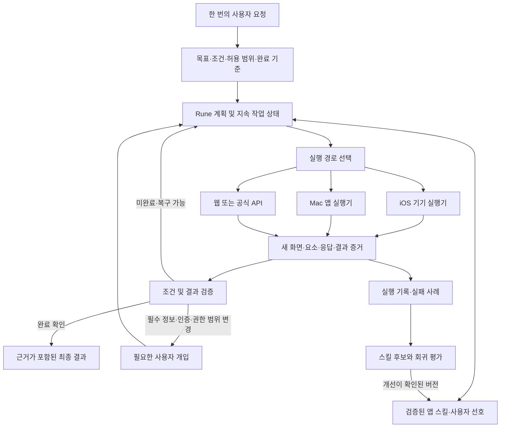

# Rune: 한 번의 요청으로 여러 앱의 작업을 끝내는 에이전트

후속 조사: [사용자별 원격 기기·VM 실행 검토](CLOUD_EXECUTION_RESEARCH.ko.md). 원격 로그인, 카카오톡 보조 기기, 결제 인증, 세션 보존, 호스팅 비용과 iOS 배포 조건을 구체화했다.

조사일: 2026-10-19, Asia/Seoul. 논문 원문·저자 공식 저장소·플랫폼 공식 문서와 현재 Rune 소스를 대조했다. 아래 수치는 해당 연구의 보고값이며 이 작업에서 재현한 성능이 아니다. 국내 세 앱의 실기기 조작·주문·예약은 실행하지 않았다.

이 문서는 앞선 `RESEARCH.ko.md`의 플랫폼/API 조사를 확장하고 제품 방향을 수정한다. iOS 화면을 만드는 것과 사용자의 실제 일을 완료하는 것은 별개의 성과다. 이번 목표는 **한 번 요청하면 앱 탐색, 정보 수집, 조건 판단, 실행, 결과 확인까지 이어지는 제품**이다. 파일 수동 내보내기나 마지막 단계의 수동 조작은 보조 경로로 기록하며 자동 완료에 포함하지 않는다.

## 1. 결론과 설계 판단

제한된 앱·작업부터 실제 완료율을 높이고 범위를 확장하는 접근은 연구 근거가 있다. 다만 일반 iPhone 앱 하나만으로 임의의 다른 앱을 자유롭게 읽고 조작하는 배포 경로는 확인하지 못했다. 모델의 추론 능력과 운영체제가 허용하는 실행 권한을 각각 해결해야 한다.

권장 구성은 **iPhone의 요청 UI + 지속 실행되는 Rune 엔진 + 교체 가능한 기기 실행기 + 앱별 작업 지식 + 결과 검증기**다. Mac/별도 기기 사용 가능 여부는 아직 확정되지 않았으므로 두 배포 조건을 구분한다.

- Mac/기기 연결 허용: 실제 iPhone + Appium/XCUITest 경로를 우선 실험한다. 사용자의 같은 iPhone을 조작하려면 앱 전환 동안 Rune UI가 백그라운드로 가고 기기를 점유하는 흐름까지 측정한다. 웹·Mac 앱으로 같은 목적을 수행하는 대안은 사용자에게 실행 위치를 표시한다.
- iPhone 한 대·일반 설치만 허용: 공개 API, 대상 앱의 App Intent, 웹 기능으로 가능한 작업부터 제공한다. 현재 확인한 권한으로 세 앱의 모든 화면을 제어한다고 약속할 수 없다.
- 별도 Android 실행 기기는 넓은 앱 조작을 검증하는 대안이다. 그러나 계정·지역·기기별 대화 이력이 같다는 보장이 없으므로 사용자의 iPhone을 조작한 것과 동등하게 취급하지 않는다.

**지원 단위는 앱 이름이 아니라 `앱 × 작업 × 버전 × 실행 경로 × 계정 조건`이다.** “카카오톡 지원”보다 “선택한 방에서 지정 기간의 텍스트를 빠짐없이 수집하고 근거가 있는 요약 생성”을 먼저 입증한다. 범용 실행기가 처음 보는 화면을 처리하고, 검증된 앱별 스킬이 반복 작업을 안정화하는 혼합 구조를 제안한다.

## 2. 논문에서 확인한 것

최근 연구를 우선 확인했고, 오래된 논문은 설계의 출처로만 사용했다. 서로 다른 벤치마크의 점수를 모델 순위처럼 비교하지 않는다. 특히 클릭 위치 정확도, 부분 진행률, 최종 작업 성공률은 다르다.

| 연구 / 발표 | 환경과 보고 결과 | 해석의 한계 | Rune에 적용할 내용 |
|---|---|---|---|
| [iOSWorld, arXiv:2606.09764](https://arxiv.org/html/2606.09764v1), 2026-06 | 직접 제작한 SwiftUI 앱 26개, 작업 133개, iOS 시뮬레이터. Opus 4.6은 화면만 사용 시 26.3%, 화면+XML 조건에서 51.9%. 후자의 단일 앱 81.5%, 여러 앱 36.7% | 실제 국내 앱이 아니다. XML 조건에는 앱 실행·요소 선택 등 추가 행동 도구도 있어 상승분을 XML 효과로만 볼 수 없다. 50단계 제한, 모델 판정 기반 | 화면과 구조화된 요소를 함께 관찰하되, 앱 전환·도구 설계·긴 작업을 별도 평가 |
| [Qwen-UI-Agent, arXiv:2607.28227](https://arxiv.org/html/2607.28227v1), 2026-07 | MobileWorld **GUI-only 117개 작업**에서 82.1%. 중국 Android 실기기 MobileWorld-Real **409개 작업·104개 앱**에서 92.2% | 실기기 점수는 CAPTCHA·로그인 만료 등 환경 오류를 분모에서 제외한다. 5개 VLM의 다수결 판정이며 인간 판정과 일치도는 666개 실행에서 92.8%. 무개입 거래 성공률과 다르다 | 실기기·실계정 상태를 평가에 포함하고, 제품 완료율에는 환경 장애도 포함해 보고 |
| [Qwen-Planner-Agent, arXiv:2609.29892](https://arxiv.org/html/2609.29892v1), 2026-09 | MobilePA-Bench 1,700+ 작업·200+ 도구. 동일 27B 체크포인트에 실행 지원 체계를 추가하면 71.90%→77.05% | 통제된 도구 기반 모바일 계획 평가다. 실제 iPhone 화면 조작 성능으로 옮겨 읽을 수 없다. 저자 보고이며 독립 재현 미확인 | 모델 교체와 별도로 지속 상태·메모리·스킬·실행 피드백을 개선하고 같은 모델로 비교 실험 |
| [MobileWorld, arXiv:2512.19432](https://arxiv.org/html/2512.19432v1), 2025-12 | Android 앱 20개·작업 201개. 62.2%가 여러 앱 작업, 평균 27.8단계. 원 논문의 최고 조합 51.7% | 초기 결과를 현재 성능 상한으로 사용하면 안 된다. 위 82.1%는 GUI-only 부분집합이므로 전체 201개 점수와 직접 비교 불가 | 사용자 상호작용·GUI·도구 사용을 포함한 작업 평가, 상태 초기화 및 결과 검사 설계 |
| [OSWorld2.0, arXiv:2606.29537](https://arxiv.org/html/2606.29537v1), 2026-06 | 긴 데스크톱 작업 108개. 논문 평가에서 최고 완전 성공 20.6%, 부분 진행 54.8% | 데스크톱·재현 환경의 결과다. 모바일 점수나 현재 모든 모델의 상한이 아니다 | 중간 단계의 성취와 최종 완료를 분리. 여러 조건을 모두 만족했는지 확인 |
| [Mobile-Agent-v3.5, arXiv:2602.16855](https://arxiv.org/abs/2602.16855), 2026-02 | GUI-Owl-1.5 모델군 및 여러 플랫폼의 화면 조작 연구. [공식 구현](https://github.com/X-PLUG/MobileAgent) 공개 | 모델의 화면 이해와 iOS 실행 권한은 별개. 한국어·국내 앱에서 재검증 필요 | 교체 가능한 GUI 모델 후보. 처음부터 자체 기반 모델을 학습할 이유는 약함 |
| [AndroidWorld, arXiv:2405.14573](https://arxiv.org/abs/2405.14573), 2024-05 | 실제 오픈소스 Android 앱 20개, 상태 기반으로 평가하는 작업 116개 | 소비자 상용 앱과 실행 조건이 다름. 초기 모델 점수는 현재 판단에 사용하지 않음 | 작업 초기화·종료 상태 검사·반복 가능한 평가 방식 재사용 |
| [AppAgent, arXiv:2312.13771](https://arxiv.org/abs/2312.13771), 2023-12 | 탐색 또는 사람의 시연에서 앱 사용 지식을 만들고 다음 실행에 활용 | 오래된 기초 연구이며 모든 앱 자동 학습이나 최신 성능의 증거는 아님 | 새 앱 도입을 시연→스킬 후보→검증→활성화 과정으로 설계 |

연구에서 특히 중요한 반례는 “실기기 90%대”가 곧 “어떤 요청이든 한 번에 완전히 처리”를 뜻하지 않는다는 점이다. Qwen-UI-Agent는 실제 결제·예약 등 외부 결과가 있는 작업에 사용자 확인을 두며, 환경 오류를 별도 집계한다. 또한 복구하기 어려운 과거 주문·장바구니·카드 상태에 의존하는 작업은 평가에서 피한다. 국내 앱의 로그인 만료, 개인 쿠폰, 기존 주문 중복까지 검증해야 Rune의 제품 성능이 된다. [원문 §2.5, §3.1–3.2](https://arxiv.org/html/2607.28227v1)

연구 공개와 바로 사용할 수 있는 배포물도 구분했다. Qwen-Planner-Agent 저장소는 보고서·소개·기록된 예시를 제공하며 모델/학습/에이전트 구현 공개로 취급하지 않는다. Qwen-UI-Agent 디렉터리에서 확인한 파일도 보고서·README·assets이므로 논문 속 신모델을 즉시 설치할 수 있다는 전제로 계획하지 않는다. 이전 MAI-UI 공개 가중치와 혼동하지 않는다. [Planner 저장소](https://github.com/Tongyi-MAI/Qwen-Planner-Agent), [UI 저장소](https://github.com/Tongyi-MAI/MAI-UI/tree/main/Qwen-UI-Agent)

## 3. iOS 실행 경로의 검토

| 경로 | 가능한 역할 | 결정 |
|---|---|---|
| 일반 Rune iOS 앱 | 요청·진행 상황·결과 표시, 자신의 데이터 처리, 허용된 서비스 연결 | 요청 창구로 사용. 임의 타 앱의 UI 제어 권한은 확인되지 않음 |
| App Intents / Shortcuts | 대상 앱이 공개한 기능 호출 | 설치된 대상 앱의 실제 action·인자·반환값을 조사. Rune이 Intent를 만들었다고 타 앱 기능이 생기지 않음 |
| Mac + XCUITest/Appium/WDA + 실제 iPhone | 개발/테스트 환경의 UI 관찰·입력 | 가장 먼저 검증할 iOS 조작 후보. Xcode, 기기 신뢰, Developer Mode, WDA 서명/프로비저닝 준비 필요 |
| iOSWorld 시뮬레이터 | 재현 가능한 iOS 에이전트 평가 | 플랫폼 실행기와 계획/복구 검사에 사용. 실제 App Store 앱 실행 결과로 표시하지 않음 |
| Mac iPhone Mirroring | Mac에서 iPhone 화면 클릭·입력·스크롤 | 보조 실험. Rune과 결합한 안정성은 미측정. iPhone을 잠금 해제하면 미러링이 종료되어 같은 폰에서 Rune UI를 계속 보는 흐름과 충돌 |
| 웹 / Mac 앱 / 권한 있는 API | 동일 계정에서 가능한 일부 실제 작업 | 결과 동등성을 작업별로 확인한 뒤 경로 선택. 앱 전용 재고·쿠폰·대화 이력을 같다고 가정하지 않음 |

근거: [Apple sandbox](https://support.apple.com/guide/security/security-of-runtime-process-sec15bfe098e/web), [App Intents](https://developer.apple.com/documentation/appintents/creating-your-first-app-intent), [Appium 기기 준비](https://appium.github.io/appium-xcuitest-driver/latest/getting-started/device-setup/), [Apple iPhone Mirroring](https://support.apple.com/en-euro/120421).

**첫 실험의 질문은 “모델이 똑똑한가”보다 “이 경로에서 실제 세 앱을 열고, 필요한 화면을 읽고, 입력 결과를 다시 확인할 수 있는가”이다.** 화면·요소 트리·키보드·앱 전환·팝업·연결 단절을 확인한 후 모델 비교로 넘어간다. 접근성 트리가 빈 화면은 이미지 기반으로 처리할 수 있는지 확인하고, OCR이 못 읽은 값은 추정해 채우지 않는다.

상시 켜진 Mac이 없는 일반 사용자 배포와 개인 개발 환경은 별도 제품 단계다. 실기기 WDA 성공이 App Store 배포 적합성이나 모든 사용자에게 동일한 설치 경험을 보장하지 않는다. [App Review Guidelines](https://developer.apple.com/app-store/review/guidelines/)

## 4. 세 앱의 완료 조건과 실험 범위

### 카카오톡: 지정 대화 수집부터 요약까지

공식 개발자 지원은 개인 대화내용 API를 제공하지 않는다고 답했고, 현재 메시지 API는 발송 기능이다. 이 사실은 GUI 경로의 가능성을 부정하지 않는다. [공식 답변, 2023-02](https://devtalk.kakao.com/t/api-or-sdk/127685), [메시지 문서](https://developers.kakao.com/docs/ko/kakaotalk-message/common)

목표 예시: “프로젝트 A 단톡방의 지난주 대화를 읽고 결정 사항, 내가 할 일, 기한을 정리해 줘.”

- 실행: 방 식별 → 기간 확정 → 검색/스크롤/가능한 내보내기로 원문 수집 → 중복 제거 → 근거와 연결된 요약.
- 완료 검사: 다른 방과 혼동하지 않았는지, 기간의 시작/끝까지 수집했는지, 수정된 약속은 최신 메시지를 반영했는지, 담당자·날짜가 원문과 일치하는지 확인.
- 별도 상태: 사진·첨부·삭제 메시지 또는 불러오지 못한 과거 대화가 있으면 수집 범위를 표시. 일부 화면을 읽고 전체 대화를 요약했다고 보고하면 실패.
- 경로: 실제 iOS UI를 우선 확인하고 Mac 카카오톡을 대안 비교. Mac에 필요한 과거 대화가 동기화되어 있는지는 실측한다.

사용자가 매번 텍스트를 내보내서 붙여 넣는 흐름은 이 목표의 자동화 성공으로 집계하지 않는다. 초기 데이터 검증과 복구용으로는 유용하다. 대화 내용은 작업 데이터이며, 그 안의 명령이 원래 사용자의 지시·권한을 바꾸지 못하게 한다.

### NOL(야놀자): 조건 검색부터 예약 확인까지

공식 소비자 웹에서 숙소 탐색 경로를 확인했다. 호텔 공급자용 YCS API는 별도 파트너 범위이며 소비자 계정의 모든 재고·쿠폰·포인트를 쓸 수 있는 API의 증거가 아니다. [NOL](https://nol.yanolja.com/), [YCS API](https://yanoljacloudsolution.com/open-api)

목표 예시: “다음 금요일부터 2박, 성인 2명, 주차 가능, 총 30만 원 이하이고 전날까지 무료 취소되는 숙소 중 역에서 가장 가까운 곳을 예약해 줘.”

- 실행: 날짜/인원/지역 → 실제 예약 가능 객실 목록 → 총액·취소 조건 비교 → 조건에 맞는 객실 선택 → 제출 → 예약 내역 확인.
- 완료 검사: 숙소·객실·체크인/아웃·인원·세금/수수료 포함 총액·취소 마감 및 시간대가 일치하고, 새 예약번호와 예약 상태가 확인되어야 한다.
- 가격/재고 변경 시: 예산과 조건 안에서 재계획. 사용자가 허용하지 않은 상향 결제나 취소 조건 악화는 실행하지 않는다.
- 응답 유실 시: 예약 내역에서 결과부터 조회. 제출을 반복하거나 예약번호 없이 성공이라고 응답하지 않는다.

웹과 앱을 비교할 때 같은 날짜·계정·쿠폰·객실 조건을 고정한다. “최저가부터” 표시나 결제 직전 화면은 예약 완료 근거가 아니다.

### 배달의민족: 옵션·주소·금액을 지킨 주문

이번 공식 문서 검색에서는 공개 소비자 주문 생성 API를 확인하지 못했다. 사업자 주문접수/POS 연동은 이미 접수된 주문을 처리하는 기능으로 구분한다. 비공개 제휴 가능성까지 없다고 결론 내리지 않는다. [배민](https://www.baemin.com/), [주문접수PC Lite](https://ceo.baemin.com/guide/13571?share=UrlCopy)

목표 예시: “저장된 집 주소로 평소 먹는 메뉴를 배달비 포함 2만 원 안에서 주문해 줘. 품절이면 다른 메뉴는 주문하지 마.”

- 실행: 주문에 필요한 선호 근거 확인 → 주소/배달 방식 → 가게/메뉴/옵션/수량 → 최소주문·배달비·쿠폰 → 최종 금액 → 주문 → 주문 내역 확인.
- 완료 검사: 신규 주문번호, 주소, 메뉴·옵션·수량, 결제 금액, 현재 접수 상태가 원래 조건과 일치해야 한다. “접수 대기”와 “가게 수락”도 구분한다.
- 상태 변화: 영업 종료, 품절, 옵션 필수, 최소금액, 배달 불가, 개인 쿠폰 차이, 결제 인증, 타임아웃을 따로 평가한다.
- 중복 방지: `제출 전 / 제출 중 / 결과 불명 / 접수 확인` 상태를 기록. 결과 불명에서 주문 내역을 조회하기 전 재주문하지 않는다. 서비스가 지원하지 않는 idempotency key를 임의로 있다고 가정하지 않는다.

선호·주소·한도 등을 초기 설정하거나 요청에 포함하면 반복 질문을 줄일 수 있다. 결제 인증처럼 기기가 사용자에게 요구하는 동작은 별도 개입으로 기록한다. 모든 화면마다 확인받는 UX로 제품 목표를 축소하지 않는다.

## 5. 권장 실행 구조

이 구조는 연구를 바탕으로 한 **Rune 설계 제안**이며 구현 완료 상태가 아니다.

1. **요청을 지속되는 작업 명세로 만든다.** 목표, 대상 계정, 날짜, 예산, 선호, 허용된 변경, 완료 증거를 고정한다. 누락된 필수 정보만 질문하고 확인된 선호는 재사용한다. 화면에서 보인 오래된 주소나 메모리가 현재 요청을 덮어쓰지 못한다.
2. **계획과 화면 조작을 분리한다.** 상위 계획은 제약과 여러 앱의 의존 관계를 관리한다. 실행기는 현재 화면의 요소 선택·스크롤·입력을 수행한다. 처음부터 여러 모델이 매 클릭을 토론하게 만들 필요는 없다. 동일 모델의 역할 분리부터 측정한다.
3. **행동 후 새 상태를 본다.** 요소 ID가 있으면 활용하고 없으면 화면 위치를 찾는다. 관찰은 기기·앱·화면 ID·시각을 포함한다. 로딩/오버레이/키보드 상태가 변했는데 과거 좌표를 재사용하지 않는다.
4. **중간 단계와 최종 결과를 검증한다.** 검색 필터가 적용됐는지와 예약이 생성됐는지는 다른 검사다. 중요한 값은 입력 후 다시 읽고, 거래는 결과 내역을 확인한다. 성공 메시지를 생성한 모델의 자신감만으로 완료 처리하지 않는다.
5. **복구와 결과 불명을 별도로 다룬다.** 재관찰·뒤로가기·검색 수정은 재시도할 수 있다. 결제/주문 제출의 응답 유실은 결과 조회가 먼저다. 여러 앱에 걸친 작업의 앞부분만 완료되면 그 상태를 보존한다. 예약 취소처럼 비용이 있는 보상 동작을 단순 되돌리기로 취급하지 않는다.
6. **기기 점유를 명시한다.** 같은 기기 화면의 입력은 직렬화하고 사용자 조작과 충돌하면 관찰부터 다시 시작한다. 네트워크 중단·엔진 재시작 후에도 작업 ID와 확인된 결과를 복구한다.

“한 번 요청”은 내부 모델 호출도 한 번이라는 뜻이 아니다. 사용자가 지시를 반복하지 않아도 Rune이 관찰·수정·재시도·검증을 이어가는 경험이다. 예컨대 각 단계 성공 확률이 독립적으로 99%라고 단순화해도 30단계를 모두 통과할 확률은 `0.99^30 ≈ 74.0%`다. 이는 실제 성능 추정치가 아니라, 단계 정확도만 높이고 복구를 생략하면 긴 작업의 신뢰도가 떨어진다는 설명용 계산이다.

## 6. 현재 Rune에 있는 기반과 빈칸

소스 관찰 결과이며 실제 모바일 동작 검증이 아니다. 기존 작업 중인 파일은 수정하지 않았다.

| 항목 | 현재 코드에서 확인한 기반 | 필요한 확장 |
|---|---|---|
| 화면 관찰과 입력 | `rune/computer/protocol.py`, `observation.py`: 구조화된 행동, 관찰 ID, 오래된 화면 입력 방지, 반복 정체 감지 | iOS transport, 기기/앱/화면 좌표, 회전·키보드·앱 전환 의미 모델 |
| 실행 흐름 | `rune/computer/session.py`: 세션/입력 잠금, 결과 불명 상태, 행동 검토 | 현재 native 입력은 매번 사용자 검토를 요청한다. 작업 단위 허용 범위와 내부 행동 검증을 설계해야 한 번 요청 UX가 가능 |
| 완료 판정 | `rune/agent/run_outcome.py`: 완료와 검증을 구분. `browser/checks.py`: 값 재확인·결과 증거 구분 | 세 앱의 대화 수집 범위·예약번호·주문 상태처럼 도메인별 판정 규칙 |
| 재시작/복구 | `rune/agent/execution_journal.py`: 실행 기록, 재사용, 결과 불명 보호 | 외부 주문·예약의 결과 조회와 중복 방지. 일반 도구 replay가 거래의 정확히 한 번 실행을 보장하지 않음 |
| 스킬 확장 | `rune/skills/lifecycle.py`, `evaluation.py`, `replay.py`: 후보/검증/활성 상태, 스킬 유무 비교 평가 | 실기기 상태 초기화, 앱 버전별 테스트 자료, 보류된 스킬 재검증. 현 replay는 복사한 작업공간 중심 |
| iOS 화면 | `ios/Rune/*`: 서버 연결 클라이언트 소스 | 실기기 빌드 및 실행기 연결. 클라이언트 UI 테스트를 타 앱 조작 성능으로 세지 않음 |

기존 검토 체계를 무조건 끄는 변경은 제안하지 않는다. **사용자가 요청한 작업의 범위·예산·대상을 한 번 정하고, 그 안의 반복 탐색은 자동 진행하며, 범위 밖 변화만 다시 묻는 정책**이 필요하다. 현재 코드와 다른 제품 정책이므로 구현 전에 실행 명세와 함께 설계해야 한다.

## 7. 앱을 점차 늘리는 방법

새 앱마다 전체 에이전트를 따로 만드는 대신 공통 동작을 재사용한다. 검색, 날짜 선택, 리스트 순회, 페이지 끝 감지, 상세 조건 추출, 입력값 재확인, 내역 조회 등을 기기별 실행기 위에 둔다. 앱별 스킬은 화면 의미와 작업 규칙을 보완하며, 고정 좌표의 긴 매크로에 의존하지 않는다.

앱/작업 등록에는 최소한 다음 자료가 필요하다.

| 등록 항목 | 예 |
|---|---|
| 식별과 범위 | 앱 ID, 버전, 언어, OS, 로그인 상태, 지원 작업 |
| 실행 가능 조건 | 필요한 기기 연결, 계정, 사용자 선호, 초기 화면 |
| 입력/출력 계약 | 날짜·총액·주소 / 원문 범위·주문번호·예약 상태 |
| 실행 지식 | 진입점, 화면의 의미, 필수 옵션, 대체 경로 |
| 완료 판정 | 버튼을 누른 사실이 아닌 실제 결과와 제약 충족 |
| 실패/재시도 규칙 | 품절, 세션 만료, 응답 유실, 중복 조회, 사용자 인계 |
| 검증 이력 | 개발/미공개 평가 작업, 앱 버전, 반복 성공률, 실패 유형 |

진입 단계는 `탐색 확인 → 읽기 완료 → 수정/준비 완료 → 거래 완료 → 여러 앱 연결`로 관리한다. 이 단계는 자동화 목표를 줄이기 위한 것이 아니라 각 범위가 실제로 동작하는지 표시하기 위한 것이다.

실행에서 배운 절차는 곧바로 운영에 반영하지 않는다. 실패 원인을 화면 인식·계획·실행기·정보 부족·완료 판정으로 나누고, 후보 스킬을 같은 초기 조건의 스킬 없음/있음 실행으로 비교한다. 기존 Rune의 활성화 판정 구조를 재사용한다. 새 버전이 기존 작업을 망가뜨리면 이전 스킬로 돌아간다. 개인 대화나 주문 정보를 공용 스킬에 넣지 않는다.

확장 순서는 앱 수보다 **완료 가능한 사용자 여정과 재사용 효과**로 정한다. 카카오톡의 대화 근거→일정, NOL의 숙소 조건→지도 이동 시간→예약, 배민의 메뉴 선택→주문 확인처럼 연결한다. 캘린더·지도·메일 등의 실제 연동 가능 기능은 각 공식 API/앱 UI를 별도로 조사한 뒤 포함한다.

## 8. 평가와 개발 순서

아래는 제안이며 실행 결과·확정 일정이 아니다. 현재 환경에서 Xcode 및 실기기 경로가 확인되지 않아 소요 기간을 근거 없이 고정하지 않는다.

| 단계 | 검증할 것 | 다음 단계로 넘어갈 증거 |
|---|---|---|
| A. 실행 경로 검증 | 실제 세 앱 열기, 화면 읽기, 검색어 입력/재확인, 스크롤, 앱 전환, 중단 복구 | 앱별 동작 기록, 관찰 방식과 실패 원인. 한 앱만 성공한 결과를 전체로 확대하지 않음 |
| B. 읽기 작업 완주 | 카카오톡 지정 기간 요약, NOL 조건별 숙소 비교, 배민 메뉴/옵션 확인 | 원문/실제 화면과 수동 대조한 결과, 누락 및 잘못된 완료 판정 기록 |
| C. 주문·예약 완주 | 테스트 가능한 환경에서 제출/내역 확인/응답 유실 복구. 실제 거래 검증은 그 실험에 대한 명시적인 실행 범위가 있을 때 수행 | 조건 일치, 결과 식별자, 중복 없음, 필수 인증/개입 횟수 |
| D. 반복 신뢰도 | 앱별 10개 작업 × 5개 초기 조건/상태를 시작점으로 총 150개 실행. 개발 자료와 최종 평가 분리 | 앱/작업별 성적표, 실패 분포, 시간·비용. 이 표본만으로 99% 보장하지 않음 |
| E. 앱 확장 | 공통 동작 재사용 및 새 앱 스킬 학습, 기존 앱 회귀 검사 | 새 작업의 개선과 기존 작업 유지가 모두 확인됨 |

공개 벤치마크는 실행 체계를 비교하는 용도이고, 국내 앱 평가는 제품을 검증하는 용도다. iOSWorld의 합성 앱, AndroidWorld/MobileWorld의 재현 환경, 국내 실서비스 결과를 한 성공률로 합치지 않는다. 실거래를 반복 발생시키는 방식으로 150개 평가를 채우지 않고, 거래 전 흐름·재현 환경·제한된 실거래의 결과를 각각 표시한다.

제품 지표는 다음과 같이 정의한다.

- **요청 단위 완료율:** 시작한 유효 요청 중 모든 조건과 최종 증거를 충족한 비율. 내부 재시도는 한 실행에 포함하고 반복 요청으로 성공률을 부풀리지 않는다. 환경 장애도 사용자 관점의 미완료에 포함하며 원인을 따로 보고한다.
- **무개입 완료율:** 요청 이후 추가 입력/수동 조작 없이 완료한 비율. 로그인·결제 인증을 제외한 보조 지표도 제공할 수 있지만, 제외하지 않은 수치를 함께 제시한다.
- **거짓 완료율:** 완료했다고 보고했는데 원문·내역·조건 검사에 실패한 비율. 실행 모델과 별도의 검사 자료로 측정한다.
- **반복 신뢰도:** 같은 작업을 변화된 초기 상태에서 5회 수행했을 때 5회 모두 성공하는 비율. 한 번 성공한 데모와 구분한다.
- **제약 위반·중복 거래:** 발생 건수와 원인을 별도로 집계. 결과 불명을 성공/실패 어느 쪽으로도 임의 확정하지 않는다.
- **시간과 비용:** 전체 요청의 p50/p95 및 성공/실패별 분포. 입력·출력 모델 비용, 도구, 기기 실행까지 포함한다.

검증기도 틀릴 수 있으므로 다른 방·잘못된 날짜·이전 예약번호·제출 버튼만 보이는 화면·불완전 수집·성공처럼 보이는 팝업을 포함해 거짓 통과를 시험한다. 표본을 사람이 대조하고, 원문이 없는 값은 확인 불가로 남긴다.

예비 내부 목표는 읽기 작업 95% 이상으로 둘 수 있지만 이는 제안 기준이다. 거래 지원은 평균 점수 하나가 아니라 조건 위반과 중복, 결과 불명 처리까지 보고 판단한다. 독립·동일 분포라고 가정해도 100회 모두 성공했을 때 성공 확률의 단측 95% 정확 하한은 약 97.05%, 300회는 약 99.01%다(`0.05^(1/n)`). 실제 앱은 업데이트와 계정 차이로 이 가정이 흔들리므로 표본 수만 늘린다고 영구적인 99% 보장이 되지는 않는다.

## 9. 이번 조사로 남기는 결정 기록

- **제품 목표:** 사용자 한 번의 요청에서 최종 결과 검증까지. 수동 파일 전달/마지막 단계 인계는 자동 완료로 세지 않는다.
- **실행 방향:** iOS 실기기 제어 가능성을 먼저 확인한다. Mac/별도 기기 허용 여부에 따라 배포 범위를 나누며, iOSWorld 시뮬레이터 결과로 일반 iPhone 권한을 주장하지 않는다.
- **아키텍처:** 기존 Rune의 관찰·실행 기록·검증·스킬 평가를 확장한다. 우선순위는 기기 실행기, 앱별 완료 판정, 작업 단위 허용 범위, 반복 평가다.
- **모델 선택:** 동일한 국내 작업·기기·단계/시간 예산으로 후보를 비교한 후 결정한다. 논문 점수만으로 특정 모델을 확정하거나 자체 모델 학습부터 시작하지 않는다.
- **확장 정책:** 앱 개수보다 검증된 작업 수와 요청 단위 완료율을 관리한다. 실패 기록으로 개선하되 평가를 통과한 스킬만 활성화한다.
- **현재 증거 수준:** 문헌 조사와 소스 분석 완료. 국내 세 앱의 실제 조작 가능 범위와 완료율은 아직 미측정. 앞선 클라이언트 테스트는 이를 대신하지 않는다.

조사 방법 메모: 저장소가 요구하는 외부 근거 우선 원칙을 따랐다. 이번 세션에서는 별도로 호출 가능한 deep-research harness를 확인하지 못해 논문 원문·공식 저장소·공식 문서 교차 확인으로 수행했다. 후속 구현에서 이 결정 기록과 해당 문헌을 참조한다.
