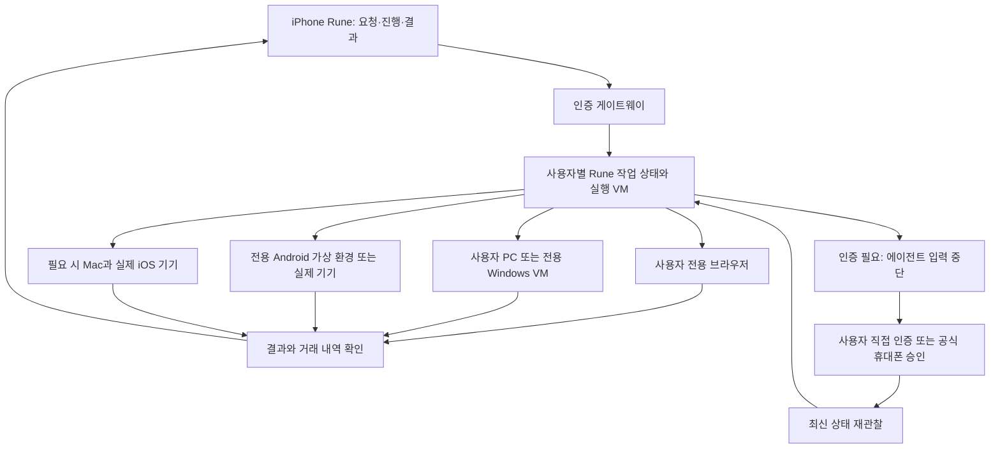

# 사용자별 원격 기기·VM에서 앱을 실행하는 Rune 검토

조사일: 2026-10-19. 범위: 사용자 iPhone → Rune → 사용자 전용 원격 환경 → 배민 주문 / 카카오톡 대화 / NOL 예약. 공식 플랫폼·서비스·호스팅 문서, 기존 에이전트 연구와 현재 소스를 대조했다. 실제 VM 생성, 계정 로그인, 앱 설치, 거래는 수행하지 않았다. 아래의 ‘가능’은 기반 기술의 존재와 설계 가능성을 뜻하며 세 앱의 실측 성공을 뜻하지 않는다.

## 1. 결론

**사용자마다 지속되는 실행 환경을 할당하고, 사용자가 로그인·인증한 뒤 에이전트가 앱을 조작하는 구조는 구현 가능하다.** 사용자의 iPhone은 요청과 필요한 인증을 담당하므로, 직접 다른 앱을 제어할 iOS 권한이 없어도 원격 실행을 요청할 수 있다.

다만 하나의 Android VM에 세 앱을 설치하고 한 번 로그인하면 모든 기능이 영구적으로 무인 실행된다는 결론은 성립하지 않는다. 기기 무결성, 카카오톡 보조 기기 정책, 대화 보유 범위, 거래별 인증이 각각 실행 범위를 정한다. **사용자별 Rune 실행 VM + 앱별로 적합한 웹/PC/실기기/Android 가상 환경**을 연결하는 구조를 권장한다. 일반 소비자 앱을 실행하는 iOS VM은 기본 경로로 채택하지 않는다.

사용자 소유 Mac 연결은 개인용 첫 경로이고, 사용자에게 PC가 없어도 되는 클라우드 제품은 별도 경로다. 클라우드 경로도 기술적으로 검토할 가치가 있지만 실제 서비스 인증과 운영비, iOS 배포 심사를 통과해야 한다.

## 2. 실행 환경별 판단

| 환경 | 기술적 판단 | 적합한 역할 / 확인할 조건 |
|---|---|---|
| 사용자 Mac/PC | 이미 로그인한 앱과 로컬 대화를 사용하는 경로 | 카카오톡 우선 후보. 기기가 켜져 있고 실제 GUI 세션·권한·연결이 유지되어야 함 |
| 사용자별 Windows VM | 정식 PC 프로그램을 설치하는 후보 | 카카오톡 PC 버전 후보. 클라우드 VM 로그인 허용·장기 세션·대화 동기화는 실측 필요. Windows/호스팅 라이선스 범위 확인 |
| 사용자별 Linux VM + 브라우저 | 서버 브라우저와 Rune 실행 환경을 격리할 수 있음 | NOL 웹을 먼저 평가. 앱 전용 기능·쿠폰까지 동일하다고 가정하지 않음 |
| 사용자별 Android VM/컨테이너 | 생성·원격 화면·ADB 입력을 제공하는 제품과 오픈소스가 존재 | 배민 등 모바일 UI 후보. Google Play/GMS, ARM 라이브러리, 무결성, 인증, 실제 거래를 각각 검사 |
| 사용자 전용 실제 Android 휴대폰/공식 지원 태블릿 | VM보다 실제 기기 조건을 충족하기 좋은 후보 | 클라우드 또는 사용자 집에 배치. 앱별 인증을 통과하는지는 별도 문제. 계정이 있는 기기는 사용자 간 임의 재사용하지 않음 |
| Mac + 실제 iPhone/iPad | Appium/XCUITest 기반 UI 자동화 후보 | iOS 전용 기능 검증용. 서명·연결·잠금·인증 등 운영 부담. 원격 휴대폰을 사용자 손의 폰과 동일하게 보지 않음 |
| iOS Simulator / Corellium | 연구·개발 용도로 존재 | 일반 App Store 앱을 자유롭게 내려받아 소비자 계정으로 사용하는 클라우드 폰의 근거가 아님 |

Android 기반 근거: [Genymotion SaaS](https://docs.genymotion.com/quickstart/saas_quickstart/), [Anbox Cloud](https://documentation.ubuntu.com/anbox-cloud/), [redroid](https://github.com/remote-android/redroid-doc). Anbox의 개요에는 VM과 컨테이너가 함께 나오지만 최신 deprecation 문서는 VM 이미지가 1.28에서 deprecated, 1.30에서 unsupported라고 안내한다. 도입 시 목표 버전의 지원 범위를 확인하고 오래된 개요만으로 VM 제품을 선정하지 않는다. [Anbox 지원 변경](https://documentation.ubuntu.com/anbox-cloud/reference/deprecation-notices/)

Corellium은 가상 iOS의 App Store·iCloud 접근을 지원하지 않으며 FairPlay로 암호화된 앱을 그대로 실행할 수 없다고 명시한다. 따라서 iOS VM을 추가하면 배민·카톡이 해결된다는 주장은 근거가 없다. Simulator도 개발자가 대상 플랫폼에 맞게 빌드하는 환경이다. [Corellium 앱 제한](https://support.corellium.com/features/apps/testing-ios-apps), [iOS 제한](https://support.corellium.com/devices/ios), [Apple 실행 대상 문서](https://developer.apple.com/documentation/Xcode/running-your-app-on-simulated-or-physical-devices)

## 3. 카카오톡: 원격 로그인은 가능하지만 기기 역할이 중요

카카오 공식 고객센터는 웹 검색 도구에서 일부 본문이 누락되어, 실제 브라우저의 공개 고객센터 화면에서도 확인했다. 로그인한 개인 계정에는 접근하지 않았다.

### 확인된 공식 조건

1. **PC/Mac QR 로그인 경로가 있다.** 모바일 카카오톡 스캐너로 PC/Mac의 QR을 읽고 미등록 기기라면 계정 인증을 진행한다. 이는 원격 PC에서 사용자 인증을 받는 설계의 근거다. 단, 같은 iPhone 화면에 띄운 QR을 그 폰의 카메라로 바로 스캔할 수는 없으므로 초기 연결에 별도 화면을 쓰거나 공식 지원 로그인 방식을 확인해야 한다. [QR 로그인](https://cs.kakao.com/helps_html/1073203911)
2. **모바일과 PC/Mac은 동시 이용 가능하지만 PC/Mac끼리는 동시 이용 불가.** 클라우드 PC를 항상 켜 두면 사용자의 업무용 PC 카톡과 경쟁할 수 있다. 기존 PC를 연결하는 방법을 우선 비교해야 한다. [동시 이용 조건](https://cs.kakao.com/helps_html/1073209664)
3. **공식 지원 태블릿의 ‘다른 기기와 함께 사용’은 휴대폰 로그인을 유지한다.** 이 옵션 없이 메인 기기로 등록하면 기존 휴대폰에서 같은 계정을 사용할 수 없다. iPhone 이용자도 지원되는 Android 태블릿과 함께 사용할 수 있으나, 비지원 태블릿은 메인 기기로만 동작할 수 있다. VM을 태블릿으로 설정하는 것만으로 공식 지원을 얻는다고 가정하지 않는다. [보조 기기](https://cs.kakao.com/helps_html/1073209304), [iPhone과 Android 태블릿](https://cs.kakao.com/helps_html/1073209315)
4. **보조 태블릿 카카오톡에서 카카오페이는 지원하지 않는다는 안내가 있다.** 휴대폰의 USIM을 통한 본인인증이 필요하다고 설명한다. 카톡 요약용 원격 태블릿이 결제까지 해결한다는 설계는 잘못이다. [카카오페이 제한](https://cs.kakao.com/helps_html/1073209307)
5. **대화 접근은 로그인과 별개다.** 공식 문서는 태블릿에서 대화 등을 동기화한다고 설명하지만 모든 과거 대화를 무조건 가져온다는 뜻은 아니다. 무료 백업은 14일 복원 기한과 텍스트 위주의 제외 조건이 있고, 톡클라우드도 과거 데이터 백업 여부와 제외 대화 종류가 있다. [동기화](https://cs.kakao.com/helps_html/1073209318), [백업·복원](https://cs.kakao.com/helps_html/1073209313)

### 권장 경로

- 1순위: 사용자 기존 Mac/PC 카카오톡을 연결해 지정한 방·기간의 대화를 읽는다. 기존 대화가 있는 환경을 활용하되 사용자 조작과 입력 소유권을 조정한다.
- 클라우드 후보 A: 사용자별 Windows VM + 공식 PC 카카오톡. 사용자의 다른 PC 카톡과 동시 사용 제약을 제품에 반영한다.
- 클라우드 후보 B: 공식 지원 실제 Android 태블릿을 사용자에게 고정 할당하고 보조 기기 모드로 연결한다. 과거 대화 복원·실시간 동기화·앱 접근성은 실측한다.
- 일반 Android VM: 보조 기기 지원이 확인되기 전에는 실사용 계정의 새 메인 기기로 인증하지 않는다. 이를 범용 카톡 동기화 방법으로 홍보하지 않는다.

완료 기준은 방 식별, 지정 기간의 수집 범위, 원문 근거를 가진 요약이다. 읽지 못한 과거 메시지나 첨부가 있으면 그 범위를 표시한다. 카톡 로그인 API나 OAuth 동의가 개인 대화 열람 API를 새로 제공하지는 않는다. [개인 대화 API 관련 공식 답변](https://devtalk.kakao.com/t/api-or-sdk/127685)

## 4. 배민·NOL: 탐색 자동화와 거래 인증을 분리

### 배민

사용자별 Android 환경 또는 실제 기기의 소비자 앱에서 주소 설정, 검색, 메뉴/옵션 선택, 장바구니, 주문 내역 확인을 자동화하는 경로를 검증할 수 있다. 이번 조사에서 배민이 해당 VM을 허용한다거나 Play Integrity를 어떤 조건으로 사용한다는 공식 보장은 찾지 못했다. 따라서 ‘VM에서 차단된다’와 ‘VM에서 주문까지 된다’ 모두 실측 전에 단정하지 않는다.

Google은 앱 제공자가 에뮬레이터·인증 기기 여부를 판별할 수 있는 Play Integrity를 제공한다. `MEETS_VIRTUAL_INTEGRITY`는 Google Play Games for PC 조건의 표식이며 모든 VM에서 금융·배달 앱의 인증을 통과시켜 주는 기능이 아니다. 실기기도 앱 접근 위험 신호와 서버 정책에 따라 제한될 수 있다. [Google 공식 판정 설명](https://developer.android.com/google/play/integrity/verdicts?hl=en)

우선 한 개의 변경하지 않은 실제 Android 기기를 기준으로 동작을 확인하고, 같은 흐름을 ARM64 가상 환경과 비교한다. 실패를 패키지 설치·실행·로그인·검색·결제·결과 확인으로 분해한다. 무결성 검사나 기기 인증을 우회하는 것을 제품의 전제로 삼지 않는다. 배송지는 사용자 요청/저장된 주소로 확인하며 원격 서버의 GPS/IP 위치를 배송지로 사용하지 않는다.

### NOL

공식 소비자 웹이 있으므로 사용자별 브라우저 세션으로 검색·비교를 먼저 검증하고, 앱 전용 기능이 필요할 때 모바일 실행기로 전환한다. 웹에서 날짜별 재고, 객실, 총액, 취소 조건, 로그인/결제, 예약 내역까지 가능한지는 아직 미실험이다. [NOL 공식 웹](https://nol.yanolja.com/)

예약 조건은 날짜·인원·객실·세금/수수료·취소 마감으로 고정한다. 최종 제출 직전에 가격을 다시 확인하고 새 예약번호를 확인한다. VM 연결이 끊겨도 외부 예약은 취소되거나 되돌아가는 것이 아니므로 재연결 후 내역을 먼저 조회한다.

### ‘인증 한 번’의 실제 범위

| 인증/상태 | 자동화 가능 범위 | 구현 조건 |
|---|---|---|
| Rune 로그인 | 사용자 실행 환경으로 라우팅 | 앱 서비스 로그인과 별도 |
| 대상 앱 첫 로그인 | 사용자가 원격 화면을 조작하거나 공식 QR/인증 요청을 완료 | 모델이 비밀번호·OTP를 대화로 수집하는 흐름을 기본값으로 삼지 않음 |
| 대상 앱 로그인 세션 | 유효한 동안 자동 재사용 가능 | 원격 디스크/기기 상태 유지. 서버 만료·철회·보안 확인을 막을 수는 없음 |
| 거래별 결제 인증 | 결제수단/서비스에 따라 추가 개입 필요 | 요청의 예산·대상에 대한 허용과 카드사/서비스의 인증 요구는 별개 |
| Face ID·기기 결합 인증 | 사용자의 iPhone 인증을 원격 Android/iPhone의 인증으로 임의 전달 불가 | 제공 서비스의 공식 교차 기기 인증이 있으면 사용. 그렇지 않으면 해당 기기에서 인증 |
| CAPTCHA·추가 확인 | 사용자에게 제어를 넘긴 뒤 재개 | 미완료 상태와 만료 시간을 보존 |

카카오페이 단건 결제는 공식적으로 결제 준비→사용자의 수단 선택·비밀번호 인증→승인 흐름을 설명하며 PC의 QR/휴대폰 요청 경로도 제공한다. 따라서 원격 탐색 후 사용자 폰에서 인증하고 실행을 이어가는 설계에는 근거가 있다. 그러나 이것은 **가맹점 연동 문서**다. Rune이 배민/NOL의 가맹점 키를 갖는다는 뜻이 아니며, 해당 서비스가 실제 노출하는 인증 경로만 사용할 수 있다. [카카오페이 단건 결제](https://developers.kakaopay.com/docs/payment/online/single-payment)

제품의 기본 약속은 ‘요청 후 가능한 작업을 끝까지 수행하고, 필요한 인증 시점에만 사용자에게 연결’이다. ‘초기 인증 이후 모든 결제가 영구 무개입’은 현재 근거로 약속하지 않는다. 결제 개입이 없는 작업도 따로 측정해 실제 무개입 완료율을 보여준다.

## 5. 사용자별 지속 실행 환경 설계

아래는 문헌과 플랫폼 조건을 바탕으로 한 제안이다.

- **고정된 사용자 환경:** 공용 기본 이미지에는 로그인 정보를 넣지 않는다. 사용자별 디스크·기기 정체성·앱 상태를 지속시킨다. 같은 사용자 VM도 여러 복제본을 동시에 활성화하지 않는다.
- **세션 유지와 실행 자원 분리:** 디스크를 보존하면서 계산 자원을 중지할 수 있지만, 정지 중에는 앱 알림 수신과 동기화가 멈출 수 있다. 요청 시 요약이면 재개 후 동기화 지연을 허용할 수 있고, 항상 감시하는 제품이면 상시 기기 비용이 발생한다.
- **기기 접근권 별도 관리:** `사용자 → Rune worker → 연결된 기기/앱/계정` 매핑을 유지한다. 사용자 인증용 스트림과 에이전트 입력은 동시에 동작하지 않도록 제어권을 넘긴다.
- **인증 구간의 직접 입력:** 사용자가 실제 서비스 화면에 직접 입력하고, 그 구간은 모델 관찰·녹화·키 입력 로그에서 제외하는 모드로 설계한다. 이것이 호스팅 운영자까지 자격 증명을 볼 수 없는 종단간 구조를 자동 보장하는 것은 아니므로 저장소와 운영 접근도 별도 격리한다.
- **실행 기록은 스냅샷과 독립:** VM 스냅샷 복원이 외부 주문을 되돌리지 않는다. 주문/예약 시도와 결과 불명 상태를 스냅샷 밖의 지속 기록에 남겨 재실행을 막는다.
- **네트워크와 기기 연결:** ADB/WDA는 인터넷에 직접 공개하지 않고 인증된 기기 브로커를 통해 접근한다. 사용자 기기는 밖으로 연결하는 터널을 후보로 삼는다. IP 지역·기기 변경은 정상 사용 환경으로 안정화하되 탐지 회피용 위조에 의존하지 않는다.

redroid 공식 예시는 privileged 컨테이너를 사용하며 공용망에 ADB를 노출하지 말라고 경고한다. 따라서 다중 사용자 제품에서 컨테이너 한 겹을 사용자 간 완전한 격리라고 가정하지 않는다. 사용자별 VM 안에 Android 컨테이너를 두는 구성을 후보로 삼되 binder/GPU/네트워크와 성능을 별도 검증한다. [redroid 실행 문서](https://github.com/remote-android/redroid-doc)

현재 저장소에는 `rune/cloud/incus.py`의 사용자별 지속 Linux VM 생성/시작/중지, `store.py`의 사용자-worker 매핑, `gateway.py`의 인증 라우팅이 이미 있다. **사용자별 VM 관리의 기반 코드는 존재한다.** 다만 이것은 Android/iOS 앱이 실행되는 VM을 완성한 증거가 아니다. 현재 `guest.py`는 Rune·브라우저 worker를 실행하고, `boundary.py`의 hosted 도구 범위에는 모바일 실행기가 없다. 네트워크 ACL도 일반 웹 접근 중심이므로 원격 기기 스트리밍·브로커 연결을 명시적으로 설계해야 한다. 이번에는 해당 코드를 변경하거나 배포하지 않았다.

## 6. 호스팅 서비스 선택과 비용

| 후보 | 조사에서 확인한 점 | Rune 판단 |
|---|---|---|
| Genymotion SaaS/PaaS | 가상 Android, ADB, 화면 스트리밍·API. GMS 기본 미포함, 별도 설치 안내. SaaS 변경은 저장 명령 없이 자동 보존되지 않음 | 빠른 호환성 실험 후보. GMS 설치 가능이 Google 인증/상용 재배포 권한 보장을 뜻하지 않음. 장기 세션 보존을 직접 확인 |
| Anbox Cloud / redroid | Android의 서버 실행 및 다중 인스턴스 기반 | 직접 운영 후보. GMS, 인증된 기기 조건, 앱 호환성, 버전별 지원과 사용자 격리 검증 필요 |
| AWS Device Farm | 테스트/원격 접근, private device 옵션. 공용 기기는 세션 후 정리하며 앱 재서명으로 기능이 달라질 수 있음 | 실사용 계정이 계속 로그인된 개인 클라우드 폰의 기본값으로 부적절. 테스트용 선택과 전용 기기 계약을 구분 |
| 직접 운영 실제 기기 | 기기·계정·앱 상태를 고정할 수 있음 | 고호환성 기준군. 하드웨어·교체·재부팅·충전·기기별 배정 운영이 필요 |

근거: [Genymotion GMS](https://docs.genymotion.com/features/opengapps/), [인스턴스 저장](https://docs.genymotion.com/tools/saas/gmsaas/gmsaas_commands/), [AWS 앱 재서명](https://docs.aws.amazon.com/devicefarm/latest/developerguide/skip-app-re-signing-on-private-devices.html), [AWS 데이터 처리](https://docs.aws.amazon.com/devicefarm/latest/developerguide/data-protection.html). AWS는 공용 기기에서 민감한 계정 정보를 입력하지 말 것을 권고하므로 개인 카톡 계정을 테스트용 공용 기기에 그대로 맡기는 계획은 채택하지 않는다.

가격 예시로 Genymotion SaaS의 조사 시점 종량제는 활성 가상 기기당 **분당 US$0.06**이다. 단순 계산하면 10분 작업 $0.60, 하루 20분×30일 $36/사용자, 30일 상시 실행 $2,592/기기다. 이는 해당 종량제의 계산이며 전체 시장 가격이나 Rune 견적이 아니다. 별도 정액/기업 요금제가 있고 모델·저장소·전송·운영 비용은 포함하지 않았다. [공식 요금](https://docs.genymotion.com/usage/saas/pricing/)

따라서 초기 실험에는 관리형 서비스를 쓸 수 있지만 사용자마다 상시 켜진 종량제 VM을 바로 배정하는 방식은 비용을 먼저 계산해야 한다. 실제 원가는 `사용자별 영구 저장 + 활성 실행 분 + 모델/도구 + 네트워크/영상 + 기기/라이선스 + 운영`으로 측정한다. 저렴한 VM으로 교체해도 로그인과 앱 호환성을 잃으면 제품 비용이 낮아진 것이 아니다.

## 7. iOS 앱 배포에서 별도로 확인할 점

원격 실행이 가능해도 App Store 배포 승인이 자동으로 따라오지는 않는다. Apple 4.2.7은 특정 소프트웨어/서비스를 미러링하는 원격 클라이언트에 사용자 소유 호스트·로컬 네트워크 등의 조건을 두고, 클라우드 앱 thin client의 부적합성을 명시한다. 일반적인 전체 원격 데스크톱, 서버 기반 작업 에이전트와의 적용 관계는 실제 UI/기능에 따라 검토해야 한다.

Rune 자체의 요청·작업 관리·검증 결과 UI를 중심에 두고 필요한 인증 때 원격 화면을 제공하는 설계를 제안하지만, 이 UI 구성이 심사 통과를 보장하거나 4.2.7을 회피한다는 뜻은 아니다. 웹에서 먼저 실행 가능성과 인증 흐름을 검증하고, iOS 배포는 별도 기준으로 판단한다. 음식·숙박 결제는 외부에서 소비되는 재화/서비스에 대한 3.1.3(e), Rune 디지털 구독료는 별도 결제 규정을 검토한다. [Apple App Review Guidelines](https://developer.apple.com/app-store/review/guidelines/)

## 8. 다음 실험과 판정 기준

구조 전체를 먼저 구축하지 않고 서로 다른 실패 원인을 분리할 수 있는 최소 비교 실험을 제안한다.

| 실험 | 확인할 항목 | 통과 조건 |
|---|---|---|
| 실제 Android vs ARM64 가상 Android | 정식 배민/NOL 설치, 로그인, 검색, 장바구니/예약 직전까지 | 동일 작업의 성공/실패 위치와 원인을 기록. 설치 성공만으로 주문 가능 판정 금지 |
| 기존 PC vs Windows VM 카카오톡 | 공식 로그인, 모바일 유지, 다른 PC와 충돌, 지정 방·기간 접근 | 기존 사용자 환경을 깨뜨리지 않는 경로와 대화 보유 범위 확인 |
| 공식 지원 보조 태블릿 | iPhone 주 기기 유지, 로그인, 과거/새 대화 동기화 | 메인 기기 전환 없이 필요한 원문 접근. VM 태블릿은 별도 지원 여부 확인 |
| 세션 지속성 | 재부팅·중지/재개·24시간/7일 경과·앱 업데이트 | 재인증 필요율, 데이터 유지, 동기화 지연 측정. 단기 결과로 영구 지속 보장 금지 |
| 인증 인계 | 사용자 폰의 서비스 인증, 만료, 취소, 재개 | 사용자 인증 완료 후 같은 작업을 이어감. 인증 취소를 성공으로 처리하지 않음 |
| 실제 주문/예약 | 구체적 테스트 거래 범위 내 제출·내역 확인·응답 유실 | 조건에 맞는 신규 주문/예약번호, 중복 없음. 별도 거래 실행 권한 없이 구매하지 않음 |

기술 선택 기준은 VM이 싸다는 이유가 아니라 **유효 요청의 최종 완료율, 추가 인증 빈도, 기존 사용자 기기와의 충돌, 원문 접근 범위, 총 실행비**다. Qwen-UI-Agent 연구도 가상 환경의 대규모 학습과 실제 기기 운영을 분리하고 사용자 인증/결제 인계를 포함한다. 이를 VM만으로 모든 실서비스가 해결된다는 근거로 사용하지 않는다. [논문 §2.2](https://arxiv.org/html/2607.28227v1)

결정 기록: 사용자별 지속 Rune VM은 유지/확장할 기반으로 선택한다. 실제 앱 실행기는 교체 가능하게 두고, **NOL은 웹, 카톡은 기존 PC/공식 보조 태블릿, 배민은 인증된 실제 Android 기준군과 가상 Android 비교**부터 검증한다. 이번 조사로 확보한 것은 실행 경로와 공식 제약이며, 세 앱의 실제 로그인·거래 완료율은 아직 미측정이다.
