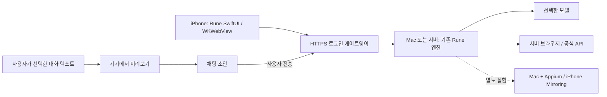

# Rune iOS 실행 및 국내 앱 조작 리서치

> 후속 검토: [한 번의 요청으로 여러 앱의 작업을 끝내는 에이전트 연구](AGENT_RESEARCH.ko.md). 아래 문서는 초기 플랫폼/API 조사 기록이다. 제품 목표·개발 우선순위·논문 분석은 후속 문서를 따른다. 수동 파일 가져오기나 앱 인계는 완전 자동 실행을 충족하지 않는다.

조사 기준일: **2026-10-19 (Asia/Seoul)**. 공식 문서·공식 개발자 지원 답변을 확인하고, 코드 구현과 문서상 가능성을 구분했다. 실제 계정의 대화 열람, 주문, 예약, 결제는 실행하지 않았다.

## 판단

Rune의 **iOS 클라이언트**는 구현할 수 있다. 이번 변경은 기존 Python 엔진을 Mac/서버에서 실행하고 SwiftUI/WKWebView로 연결하는 방식이다. iOS 앱 자체에서 다른 앱을 자유롭게 읽고 터치하는 범용 에이전트와는 실행 권한이 다르다. Apple은 제3자 앱 간 접근을 sandbox와 명시적인 시스템 API로 제한한다. 이 제약을 기준으로 독립 앱의 범용 UI 제어는 지원 대상으로 잡지 않았다. [Apple 플랫폼 보안](https://support.apple.com/guide/security/security-of-runtime-process-sec15bfe098e/web)

| 요청 | 일반 iPhone 앱으로 가능한 경로 | 제한 / 미확인 사항 | 이번 구현 |
|---|---|---|---|
| Rune 실행 | iOS 클라이언트 → HTTPS → Mac/서버 엔진 | 호스트가 켜져 있어야 함. 엔진 전체의 기기 내 실행은 별도 포팅 | 앱 소스·프로젝트·파일 가져오기 구현, 네이티브 빌드 미검증 |
| 배민 주문 | 요청 정리 후 공식 앱/지원 링크로 인계; 계약된 소비자 주문 API가 있다면 connector | 공개 소비자 주문 API를 이번 조사에서 확인하지 못함. 설치된 앱의 임의 터치 불가 | 주문 connector 미구현 |
| 카카오톡 대화 요약 | 사용자가 내보내거나 복사한 텍스트를 Rune에 제공 | 일반 대화 내역 조회 API 미제공 답변 확인; 로그인/메시지 전송 API로 해결되지 않음 | 텍스트 미리보기·초안 추가 구현. 실제 카카오톡 export 파일/모델 요약은 미실행 |
| 야놀자/NOL 숙소 목록 | 공식 웹의 숙소·조건을 서버 브라우저로 조회하고 근거 링크와 함께 비교 | 공개 페이지 열람은 확인. 날짜별 재고·총액·로그인·자동화 차단은 별도 검증 필요 | 기존 웹 도구를 활용할 수 있는 설계, NOL 전용 connector 미구현 |
| 야놀자/NOL 예약 | 공식 웹/앱 인계 또는 권한 있는 공급/예약 API 연동 | 예약·결제·취소 정책, 계정 인증 및 API 계약 범위 확인 필요 | 예약/결제 미구현·미실행 |

“공개 API를 찾지 못했다”는 결과는 해당 회사에 비공개 제휴 API도 없다는 뜻이 아니다.

## 1. iOS에서 앱 조작이 가능한 범위

### 배포용 iOS 앱

Apple App Intents/Shortcuts는 각 앱이 공개한 기능을 호출하도록 설계되어 있다. Rune이 App Intent를 추가한다고 배민/카카오톡/NOL의 내부 기능이 자동으로 생기는 것은 아니다. 대상 앱이 제공하는 action, 입력, 결과를 실제 설치 버전에서 확인해야 한다. Universal Link나 URL scheme도 앱/화면 열기와 전체 작업 수행을 구분해야 한다. [App Intent 시작하기](https://developer.apple.com/documentation/appintents/creating-your-first-app-intent)

따라서 공식 API, 대상 앱이 제공한 Intent, 사용자 공유/파일 선택, 웹에서 가능한 작업을 우선한다. WKWebView는 Rune 화면을 표시하는 수단이며 다른 설치 앱을 제어하는 권한을 주지 않는다. [WKWebView](https://developer.apple.com/documentation/webkit/wkwebview)

### Mac + 실기기 개발/테스트

Appium XCUITest/WebDriverAgent는 실제 iOS UI 자동화의 후보이다. 공식 문서는 macOS·Xcode·Appium과 WDA/XCTest 의존성을 설명한다. 실기기 서명/프로비저닝·Developer Mode 등 준비가 필요하며 앱별 화면·인증 흐름을 검증해야 한다. **개발용 제어 환경에서의 기술적 후보이지, 일반 사용자가 설치하는 Rune iOS 앱 안에 같은 제어 권한을 넣는 방식은 아니다.** [Appium 요구사항](https://appium.github.io/appium-xcuitest-driver/latest/getting-started/system-requirements/), [실기기 준비](https://appium.github.io/appium-xcuitest-driver/latest/preparation/real-device-config/)

또 하나의 후보는 Mac의 iPhone Mirroring 창을 Rune의 macOS Computer 기능으로 제어하는 것이다. Apple은 Mac에서 iPhone 화면을 클릭·스크롤·입력할 수 있다고 설명한다. **Rune 자동화와의 결합은 추론이며 미실험**이다. 화면 관찰/좌표 입력의 신뢰도, 접근성 구조, 연결 유지 등을 확인해야 한다. 미러링에서는 카메라·마이크 및 Face ID에 접근할 수 없고, iPhone 잠금/사용 상태 조건 때문에 같은 iPhone에서 Rune 앱을 사용하는 흐름과 충돌할 수 있다. [Apple iPhone Mirroring 안내](https://support.apple.com/en-euro/120421)

### 배포 심사

Apple의 public API 사용, 앱 독립성과 기능성 관련 심사 조항을 고려해야 한다. 단순 웹 래퍼의 등록 승인이나 범용 앱 조작 기능의 승인 가능성을 보장할 수 없다. 현재 구현은 개발용 출발점이며 심사 완료 제품이 아니다. [App Review Guidelines: 2.5.1, 2.5.2, 4.2](https://developer.apple.com/app-store/review/guidelines/)

## 2. 배달의민족 주문

공식 배민 페이지와 사장님 지원 문서에서는 소비자 앱 주문 및 사업자 주문접수/POS 연동을 확인했다. 특히 주문접수PC Lite는 공식 파트너 POS 여부를 확인하도록 안내한다. 이것은 **이미 들어온 주문을 가맹점이 접수하는 경로**이며 외부 앱이 소비자를 대신해 신규 주문하는 API의 근거가 아니다. [배민 공식 페이지](https://www.baemin.com/), [주문접수PC Lite](https://ceo.baemin.com/guide/13571?share=UrlCopy), [주문접수채널](https://ceo.baemin.com/guide/2050)

이번 검색 범위(`baemin.com`, `woowahan.com`, 우아한형제들 기술블로그)에서는 공개적으로 가입해 사용하는 소비자 주문 생성 API 명세를 확인하지 못했다. 내부 API가 기술블로그에 등장한다는 사실만으로 외부 접근 가능하다고 판단할 수 없다. [우아한형제들 주문 프런트엔드 기술글](https://techblog.woowahan.com/22127/)

권장 다음 단계는 소비자 주문 제휴 가능성 확인이다. API 없이 진행한다면 사용자가 선택한 상품·수량·옵션·주소·최종 총액을 확인하고 공식 앱에서 마무리하는 보조 흐름부터 만든다. 자동 UI 주문 실험은 Appium/미러링 별도 트랙으로 분리하고 주소, 옵션, 최소주문, 배달비, 쿠폰, 품절, 결제 인증, 주문번호 확인을 측정한다. 아직 실제 앱에서 어느 단계까지 자동화되는지는 모른다.

## 3. 카카오톡 대화 요약

카카오 공식 개발자 지원 답변(2023-02-13)은 개인정보 보호 때문에 대화내용 API를 제공하지 않는다고 명시한다. 오래된 답변임을 감안해 현재 메시지 문서도 대조했으며, 그 문서는 서비스 사용자 간 메시지 **발송**에 관한 기능을 설명한다. 이것을 개인/단체 대화방의 과거 내용을 읽는 API로 사용할 근거는 확인되지 않는다. [공식 지원 답변](https://devtalk.kakao.com/t/api-or-sdk/127685), [현재 메시지 문서](https://developers.kakao.com/docs/ko/kakaotalk-message/common), [메시지 FAQ](https://developers.kakao.com/docs/ko/kakaotalk-message/faq)

실현 가능한 첫 흐름은 사용자 선택 대화의 텍스트 export/복사 → Rune 입력 → 요약이다. 이번 앱의 Import text가 이 연결 구간을 제공한다. 앱 설치 버전별 내보내기 UX는 실기기 확인이 필요하다. 내용이 큰 경우 파일 첨부/청크 처리가 필요하며, 가져오기 성공과 요약 정확도를 별도로 평가해야 한다.

요약 검증은 원문에 있는 결정 사항·담당자·기한을 근거와 연결하고, 상대 날짜·수정된 약속·동명이인·사진으로만 전달된 정보를 임의 확정하지 않는지 확인한다. 자동 알림 수집이나 실시간 전체 대화 동기화는 이 export 경로의 범위 밖이다. 데스크톱 카카오톡 UI 사용도 별도 실험 대상이며 iOS 대화 API의 대체 권한으로 간주하지 않는다.

## 4. 야놀자/NOL 목록 및 예약

현재 공식 소비자 서비스는 **NOL(야놀자)** 이름을 사용하며 공개 웹에 호텔/리조트·펜션·모텔 및 개별 숙소 링크를 노출한다. 따라서 서버 브라우저를 통한 조건 검색·후보 비교는 현실적인 첫 실험이다. 다만 공개 홈 페이지의 “가격~”는 특정 숙박일·인원·객실의 확정 총액이나 예약 가능 여부를 증명하지 않는다. [NOL 공식 웹](https://nol.yanolja.com/)

Yanolja Cloud Solution 공식 문서에는 Connectivity, Channel Manager, Booking Engine 등의 API가 있고, 호텔 단위 자격 증명·재고·요금·예약 연동을 설명한다. 이는 숙박업체/파트너용 연결 계층이다. **소비자 NOL 계정의 쿠폰·포인트·전체 국내 재고를 그대로 사용해 예약할 수 있다는 의미는 아니다.** 계약 범위, 한국 재고 접근, 재판매 자격, 결제와 취소 권한을 확인해야 한다. [YCS Open API](https://yanoljacloudsolution.com/open-api)

웹 실험에서는 날짜·인원·지역을 고정하고 숙소명, 객실명, 식사/주차 등 조건, 세금 포함 총액, 취소 마감, 확인 시각, 원문 URL을 수집한다. 후보 선정 후 가격·재고를 재검증하며, 예약 제출과 예약 확인을 구분한다. 타임아웃이 발생하면 예약 내역·예약번호를 조회하기 전 같은 요청을 다시 보내지 않는 설계가 필요하다. 실제 예약 결제는 이번 조사에 포함하지 않았다.

## 5. 구현 구조 및 후속 검증

이번 변경은 iOS 호스트 UI, origin 제한, 비영구 WebKit 세션, 텍스트 import bridge, 프로젝트 설정과 검증 코드를 제공한다. 기존 인증/에이전트 로직은 재사용한다. 서버 주소 변경에 따른 교차 origin 이동을 제한하고, 파일 내용을 JavaScript 문자열 보간 대신 `callAsyncJavaScript`의 데이터 인자로 전달한다. [Apple callAsyncJavaScript](https://developer.apple.com/documentation/webkit/wkwebview/callasyncjavascript(_:arguments:in:contentworld:))

우선순위:

1. Xcode 빌드 → 실기기 로그인/SSE/파일 가져오기/키보드/백그라운드 복귀 확인. 현재 환경에는 Xcode가 없어 미완료.
2. 사용자가 선택한 카카오톡 export fixture로 원문과 요약 결과 대조. 지금은 합성 Unicode 텍스트를 검증한 상태.
3. NOL 읽기 전용 브라우저 PoC: 정해진 날짜·인원으로 5개 숙소를 비교하고 총액과 취소 조건을 수동 대조. 로그인/차단 발생 여부 기록.
4. 실제 앱 터치가 꼭 필요하면 Mac+실기기에 Appium 또는 미러링을 구성해 탐색·입력·중단·복구부터 검증. 세 앱 각각의 성공률/실패 이유를 측정한 뒤 주문·예약 범위 결정.
5. 소비자 주문/숙박 공급 API의 공식 제휴 권한이 확보되면 connector 구현. 준비 상태와 결제 결과를 구분하고 중복 실행 방지·결과 조회를 포함.

현재 결과는 **클라이언트 소스 구현 + 제한된 자동 검증 + 공식 근거 조사**이다. 세 앱의 완전 자동 조작이나 실제 거래 성공을 입증한 결과는 아니다.
