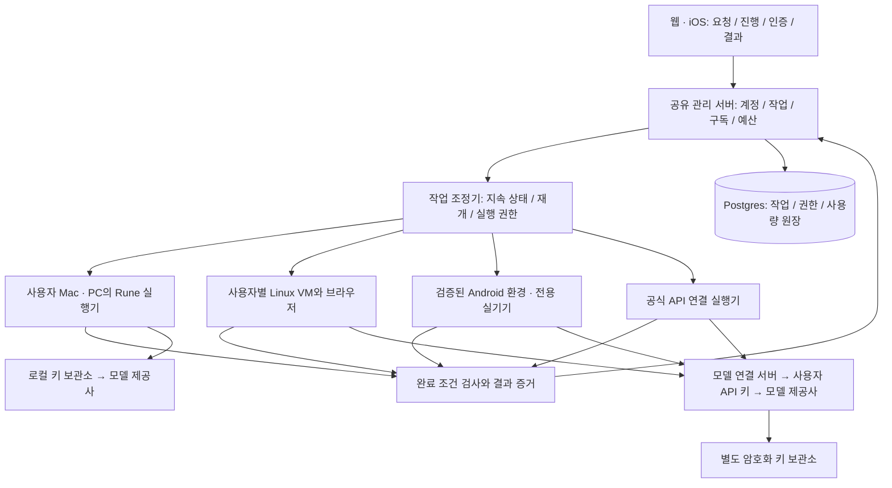

# Rune SaaS 아키텍처와 사업 모델 제안

설계일: 2026-10-19, Asia/Seoul. 상태: 설계안. 서비스 배포, 과금 연동, 실제 계정 로그인·주문·예약은 수행하지 않았다.

전제: 초기에는 개인 파워유저를 대상으로 출시하고, 이후 일반 소비자와 팀으로 확장한다. 현재 코드, 공식 플랫폼 문서, 최근 GUI 에이전트 연구를 대조했다. 저장소의 deep-research 분류·프롬프트는 확인했지만 별도 연구 하네스를 실행한 결과는 아니다. 아래 가격·출시 기준·자원 정책은 검증할 제품 가설이며 측정된 성능이나 확정 견적이 아니다.

관련 조사: [앱 에이전트와 논문](AGENT_RESEARCH.ko.md), [원격 기기·로그인·결제·VM 제약](CLOUD_EXECUTION_RESEARCH.ko.md).

## 1. 결정

**공유 SaaS 관리 서버 + 사용자별 실행 상태 + 교체 가능한 실행기 + BYOK 모델 연결**을 채택한다. 초기 판매는 **월 구독 + 선택형 클라우드 실행 요금**, 사용자 소유 컴퓨터 실행을 기본으로 한다.

- 구독료: 원격 요청, 예약 실행, 기기 연결, 작업 복구, 개인 기억 동기화, 검증된 자동화 유지·업데이트에 대한 대가.
- 모델 사용료: 초기에는 사용자가 연결한 API 계정에 직접 청구. Rune이 토큰 사용료를 추가로 붙이지 않는다.
- 클라우드 실행료: 브라우저/Android 등 실행 자원을 사용할 때 별도. 전용 실기기·상시 가동 환경은 별도 계약.
- 일반 소비자 확장: 사용량이 제한된 모델 포함 옵션을 추가할 수 있게 설계하되 초기부터 무제한 요금제를 판매하지 않는다.

사용자별 VM이 존재해도 계정 관리·스케줄링·과금·관제가 통합되어 있으면 SaaS로 운영할 수 있다. 공유 관리 기능과 격리된 실행 자원을 섞는 방식은 AWS의 bridge 모델과 부합한다. 단, 아래 구체적 구성은 Rune에 대한 설계 판단이다. [AWS SaaS bridge model](https://docs.aws.amazon.com/whitepapers/latest/saas-tenant-isolation-strategies/the-bridge-model.html)

## 2. 서비스 구성



**관리 서버가 살아 있는 것과 모든 사용자 기기가 켜져 있는 것을 분리한다.** 예약은 관리 서버가 보관하고 실행 시점에 적합한 자원을 확보한다. 사용자의 PC가 꺼져 있으면 대기·실패 상태를 명확히 표시한다. 다른 기기로 로그인 상태를 복제해 몰래 대체하지 않는다.

### 초기 배포 단위

| 구성 | 초기 선택 | 이유와 경계 |
|---|---|---|
| 웹/API | 기존 웹 UI + Python/FastAPI를 모듈별로 확장 | 현재 코드와 운영 복잡도 고려 |
| 관리 데이터 | 관리형 Postgres | 계정·작업·구독·예산 변경을 트랜잭션으로 처리 |
| 작업 배정 | Postgres 작업 테이블 + 별도 dispatcher 프로세스 | 초기에는 별도 워크플로 엔진 없이 시작. 임대 만료·재개·outbox 구현 필요 |
| 실행 서버 | 기존 Incus 기반 Linux VM을 초기 재사용 | 브라우저·코드 실행 경로. Android/Windows 실행은 별도 개발 |
| 사용자 기기 연결 | 실행기가 먼저 여는 TLS 연결, 기기별 신원·짧은 작업 토큰 | 사용자에게 공유기 포트 개방을 요구하지 않는 방향 |
| 증거 저장 | 비공개 객체 저장소 + 짧은 만료의 접근 URL | 작업 권한 검사 후 발급. 경로 접두사만으로 격리를 주장하지 않음 |
| 비밀 저장 | 관리형 secret store/KMS, 별도 broker 권한 | 모델 키·앱 토큰을 프롬프트/일반 작업 DB에서 분리 |
| 구독 결제 | 결제사와 분리된 BillingAdapter | 국내 웹은 토스페이먼츠 계약을 우선 검토, iOS는 StoreKit 경로 별도 |

Postgres의 `FOR UPDATE SKIP LOCKED`는 여러 소비자가 queue 형태의 테이블을 처리하는 용도로 사용할 수 있다. 이것만으로 작업 재개나 외부 결제의 중복 방지가 해결되지는 않는다. 작업 상태·임대·원장을 별도로 구현한다. 트랜잭션은 짧게 끝내며 모델 호출이나 사람의 인증을 기다리는 동안 DB 잠금을 유지하지 않는다. [PostgreSQL SELECT](https://www.postgresql.org/docs/current/sql-select.html)

초기에는 Kubernetes, Kafka, 여러 개의 독립 마이크로서비스를 전제하지 않는다. 다만 자격증명 broker와 불신 코드/앱 실행기는 관리 서버와 보안 경계를 분리한다. 작업량과 장애 복구 부담이 증가하면 dispatcher 인터페이스 뒤에 전문 워크플로 엔진을 도입할 수 있다.

### 실행 자원 수명

`미할당 → 생성 → 준비 → 실행 → 유휴 → 정지 → 재개`, 별도 `격리/복구/삭제` 상태를 둔다.

- 개인 브라우저 프로필, 로그인 세션, 기기 상태는 사용자별 암호화 볼륨에 유지한다. 개인 계정이 들어 있는 VM·스냅샷을 다른 고객에게 넘기지 않는다.
- 초기 Incus에서는 사용자의 VM과 디스크를 유지하고 VM만 정지/시작한다. 다른 호스트로의 볼륨 이동·자동 복구는 후속 기능이다.
- 사용자 간 공유 가능한 것은 깨끗한 기본 이미지와 호스트 자원이다. warm pool에는 로그인한 사용자 상태를 넣지 않는다.
- 유휴 정지 시간은 시작 가설 5분. 인증 대기에는 별도 짧은 유지 시간을 두고, 만료 시 안전한 지점에서 정지한다. 기기를 멈추면 인증 요청·장바구니·세션이 만료될 수 있어 재개 시 다시 관찰한다.
- 정지한 VM도 디스크·백업 비용이 든다. 자체 호스트의 고정 임대료도 사라지지 않는다. 실제 비용 절감은 동시 실행률, 호스트 통합 배치, 가동률에 달려 있다.
- 같은 사용자라도 브라우저와 Android 환경은 서로 다른 로그인 상태일 수 있다. 실행 도중 경로 변경은 재인증·중복 거래 확인이 필요한 사건이다.

## 3. 한 번의 요청을 끝까지 처리하는 실행 계약

각 요청을 자연어 문장과 함께 구조화된 `TaskContract`로 저장한다.

```text
TaskContract
  principal / tenant / credential_owner
  goal / app / account / allowed_execution_profiles
  requested_effects / forbidden_effects
  constraints: 주소, 상대방, 기간, 수량, 총액, 취소 조건 등
  completion_checks / evidence_requirements
  limits: model_cost, cloud_cost, steps, deadline, retries
  authorization_scope / expires_at / revision
```

“치킨을 집으로 3만 원 이하로 주문해 줘”의 경우 주소·메뉴 선택 범위·총액 조건을 확정하고, 그 범위 내 탐색·입력·주문을 수행한다. 이미 요청에 포함된 행동을 클릭마다 재확인하지 않는 것이 목표다. 범위를 벗어나는 가격·배송지 변경 또는 서비스가 요구하는 본인인증에서만 사용자에게 연결한다. “숙소를 찾아줘”는 예약·결제 권한으로 확대하지 않는다.

일반 화면에 나온 문구, 카카오톡 메시지, 웹 문서는 작업 데이터다. 이 데이터가 사용자 요청의 권한·예산·상대방을 바꾸지 못하게 한다. 권한 검사는 모델의 설명이 아니라 실행 직전 broker/실행기에서 수행한다.

```text
QUEUED → PREFLIGHT → RUNNING → VERIFYING → SUCCEEDED
                         ↘ WAITING_AUTH → REOBSERVE → RUNNING
                         ↘ PAUSED_BUDGET / WAITING_DEVICE
                         ↘ UNKNOWN_EFFECT → RECONCILING
                         ↘ FAILED / CANCELLED
```

주문 제출 후 연결이 끊기면 `UNKNOWN_EFFECT`로 전환한다. 주문 내역과 주문번호를 먼저 확인하고 재제출 여부를 판단한다. 조회로 판별할 수 없으면 확인 필요 상태로 남긴다. 내부 멱등키가 없는 외부 GUI 거래까지 exactly-once로 보장하지 않는다. 중단 버튼도 이미 완료된 주문을 취소하는 기능과 구분한다.

실행권은 `run_id + execution_profile_id + lease_epoch + expires_at`에 묶는다. 같은 프로필은 동시에 하나의 입력 주체만 가진다. 오래된 실행기는 fencing 검사에 실패하면 입력을 보내지 못한다. 인증 중에는 사용자가 제어권을 독점하고, 재개는 revision을 올려 이전 계획을 무효화한다.

### 서로 다른 원장 세 개

1. **작업 원장:** 어떤 행동을 시도했고 결과를 확인했는가.
2. **Rune 비용 원장:** 어떤 실행 자원과 서비스가 사용되었고 얼마를 청구할 것인가.
3. **외부 거래 증거:** 배달 주문번호·숙소 예약번호·결제 상태. Rune의 구독 결제 원장과 별개다.

분산 장애 시 세 원장을 비교해 복구한다. 외부 거래 성공 여부를 모델의 “완료” 응답이나 Rune 결제 성공으로 대체하지 않는다.

## 4. BYOK 설계

BYOK + 유료 서비스의 조합은 실제 운영 사례가 있다. OpenRouter도 제공사에 직접 비용을 내는 BYOK와 별도의 플랫폼 요금 정책을 제공한다. 이것은 조합의 실현 가능성 근거이며 Rune 구독 수요나 적정 가격을 입증하지는 않는다. [OpenRouter 현행 가격](https://openrouter.ai/pricing)

| 모드 | 키 위치 / 모델 호출 | 용도 |
|---|---|---|
| 내 기기 실행 | 사용자 OS 비밀 저장소 → 기기에서 제공사 직접 호출 | 기본 모드. Rune 서버에 모델 키를 맡기지 않을 수 있음 |
| 클라우드 실행 | Rune 암호화 보관소 → 모델 연결 서버에서 제공사 호출 | PC가 꺼져 있어도 실행. 서버가 호출 시 키를 사용할 수 있음을 명시 |
| 모델 포함 옵션 | Rune 관리 키 + 사용량 할당 | 후속 소비자용. 별도 비용/쿼터 적용 |

로컬 키 모드여도 선택한 모델 제공사에는 필요한 작업 데이터가 전달된다. 클라우드 동기화를 켜면 설정한 기억·결과도 서버로 간다. 따라서 BYOK를 “모든 데이터가 로컬에만 남는다”는 의미로 설명하지 않는다.

구현 규칙:

- 기존 LLM adapter를 재사용하되, 요청별 `CredentialRef`로 키를 선택한다. 공유 프로세스의 전역 환경변수를 사용자마다 바꾸는 방식을 금지한다.
- secret store는 write-only 등록 UI와 삭제·교체 기능을 제공한다. broker만 복호화하며 원문 키를 일반 API 응답, 로그, 프롬프트, 스크린샷에 넣지 않는다.
- 클라우드 실행기는 제한된 모델 호출 토큰만 받고 제공사 원문 키는 받지 않도록 한다. 호스트·모델·사용자·작업별 호출 권한과 상한을 검사한다.
- 초기 지원 제공사는 소수의 검증된 API로 제한한다. 비전·도구 호출·구조화 응답을 검증한 모델 조합을 표시한다. 임의 모델 선택이 동일한 작업 성공률을 보장하지 않는다.
- 계획·화면 이해·검증·재시도·요약 등 모든 유료 모델 호출을 BYOK 사용량에 포함한다. 별도 검색 API 등 비모델 비용은 포함 여부를 명시한다.
- 401/잔액 부족은 중지, 429/일시 오류는 제한 재시도. 다른 모델·키로 전환하려면 사용자가 지정한 fallback 정책 안에서만 수행한다. Rune 관리 키로 조용히 전환하지 않는다.
- 작업별·월별 예산을 호출 전에 예약하고, 응답의 실제 사용량으로 정산한다. 토큰 비용은 추정치와 제공사 확정치를 구분한다. 이미 발행된 동시 요청·제공사 가격 차이로 인한 오차를 설명하고 보수적인 여유를 둔다.
- 이미지/대화 원문을 장기 보관하는 모델 로그는 기본으로 끈다. 운영 로그에는 request ID, 모델, 지연, 토큰 수, 오류 코드 중심으로 남긴다.

암호화는 데이터 키로 비밀을 암호화하고 상위 KMS 키로 데이터 키를 보호하는 envelope 구조를 관리형 구현으로 이용한다. tenant/credential 식별자를 암호화 문맥과 접근 정책에 함께 묶는다. 암호화만으로 tenant 권한 검사가 대체되지는 않는다. [AWS KMS](https://docs.aws.amazon.com/kms/latest/developerguide/kms-cryptography.html), [Secrets Manager 암호화](https://docs.aws.amazon.com/secretsmanager/latest/userguide/security-encryption.html)

## 5. 앱 지원을 늘리는 방법

실행 경로는 공식 API → 웹 → 데스크톱 → 모바일 순서를 기본 후보로 삼되, 계정의 데이터 존재 여부·실제 기능·완료율로 최종 선택한다. “저렴한 경로”가 같은 대화 이력·쿠폰·재고를 가진다고 가정하지 않는다.

| 앱/작업 | 첫 경로 | 완료 증거 / 미확인 사항 |
|---|---|---|
| 카카오톡 지정 기간 요약 | 사용자의 기존 Mac/PC 카카오톡 | 방·기간·원문 근거·읽은 범위. 과거 이력 누락과 PC 동시 접속 제약을 검증 |
| NOL 숙소 검색·비교 | 사용자별 클라우드 브라우저 | 날짜·인원·객실·총액·취소 조건. 예약 기능은 예약번호 조회까지 별도 검증 |
| 배민 주문 | 실제 Android를 기준으로 검증 후 가상 환경 비교 | 주소·메뉴·옵션·총액·주문번호. 가상 기기 로그인/결제 호환성 미확인 |
| 후속 앱 | API/웹 우선, 모바일 실행기 재사용 | 앱 추가마다 지원 작업과 결과 검증기를 등록 |

카카오톡 PC/Mac은 동시 로그인 제약이 있어 별도 클라우드 PC가 사용자의 기존 PC 이용을 방해할 수 있다. 기존 기기 경로를 기본으로 삼는 이유다. [카카오 공식 PC/Mac 안내](https://cs.kakao.com/helps_html/1073209664)

앱 지원 manifest의 최소 필드:

```text
app_id, version_range, locale, platform, account_conditions
task_type, executor_type, required_capabilities, auth_flow
preconditions, permitted_effects, completion_verifier, recovery_policy
model_profile, evaluation_version, support_status
```

지원 상태는 `experimental → assisted → verified`로 승격한다. 임의 앱을 탐색하는 일반 에이전트와, 평가를 통과한 반복 작업을 구분해 표시한다. 앱 업데이트나 실패율 상승 시 해당 작업만 비활성화하고 이전 스킬로 되돌릴 수 있어야 한다.

Qwen-UI-Agent(2026-07)는 모바일·컴퓨터·웹 실행 환경의 공통 인터페이스, 실기기 실행, 상태 기반 verifier를 연구한다. 중국 Android의 104개 앱·409개 실사용 작업을 평가했지만 한국 앱이나 Rune의 성능을 측정한 것은 아니다. 여기서는 **실행기와 결과 검증기를 분리하는 구조**의 근거로만 사용한다. 다른 논문과 성능 해석은 앞선 [연구 문서](AGENT_RESEARCH.ko.md)에 있다. [Qwen-UI-Agent, arXiv:2607.28227](https://arxiv.org/html/2607.28227v1)

개인 대화와 스크린샷은 다른 사용자의 스킬 학습 자료에 자동 편입하지 않는다. 공통 스킬은 공개/테스트 데이터와 허용된 비식별 실패 유형으로 개선한다. 개인 기억의 원본은 기존 Markdown 원칙을 유지하고 검색 인덱스를 파생 데이터로 취급한다.

## 6. 데이터/API 경계

주요 엔티티는 `Tenant`, `Membership`, `Device`, `ExecutionProfile`, `CredentialRef`, `Run`, `Step`, `EffectReceipt`, `AuthChallenge`, `UsageEvent`, `Entitlement`, `Invoice`다. 개인 고객도 tenant를 가지되 사용자 신원과 구분한다. 향후 팀에 들어갔다고 개인 카카오톡 자격증명을 팀 전체에 공유하지 않는다.

- `POST /runs`: 요청·제약·예산 + Idempotency-Key. 같은 키의 다른 요청 본문은 충돌 처리.
- `GET /runs/{id}/events`: 진행·인증 요청·결과를 재연결 가능한 이벤트로 전달.
- `POST /runs/{id}/resume`: challenge ID + 최신 revision 확인 후 재관찰.
- `POST /runs/{id}/cancel`: 추가 행동 중단. 미확인 외부 거래는 별도 조회 후 상태 반영.
- `POST /credentials`: 전용 보안 입력. 모델 대화 메시지로 키를 등록하지 않음.
- `GET /usage`: 모델 추정비와 Rune 실행료, 예약된 예산을 분리해 표시.

tenant ID는 인증 서버가 결정하며 클라이언트·모델이 전달한 값만 신뢰하지 않는다. DB 접근에는 tenant 범위 검사와 RLS를 함께 적용하고, 실행기·객체 저장소·자격증명에도 독립적인 소유권 검사를 둔다. RLS 정책과 서비스 역할 권한은 별도 격리 테스트가 필요하다.

보존 정책 초기 가설: 인증 화면 녹화는 하지 않고, 원본 화면은 기본 비보존, 사용자가 진단 수집에 동의한 경우만 짧게 저장한다. 결과 영수증은 선택한 보존 기간까지 개인 공간에 저장한다. 계정 삭제 시 작업 배정·키 사용을 즉시 차단하고 실행 볼륨·증거·백업 만료 일정을 함께 처리한다.

## 7. BM과 가격 실험

**초기에는 유료 상품 하나로 시작한다: Rune Pro, 월 19,900원 가격 실험안.** 확정 가격이나 수요 조사 결과가 아니다. 실제 판매가격은 세금·판매채널 비용까지 반영해 정한다.

| 상품 | 제공 가치 | 비용 구분 |
|---|---|---|
| 셀프호스팅 | 현재 MIT 코어를 직접 운영 | 사용자가 모델·기기·운영 부담 |
| Rune Pro | 내 기기 원격 요청, 예약, 작업 복구, 개인 기억 동기화, 검증된 스킬 업데이트, 사용량 관리 | 구독료 + 사용자 모델 API 비용. 저장량·동시 실행 수 제한 |
| 클라우드 실행 추가 | PC가 꺼져 있어도 검증된 웹/앱 작업 수행 | Pro + 자원 종류별 실행료, 월 지출 상한 |
| 전용 기기 / 팀 | 전용 자원, 권한 관리, 운영 지원 | 원가·지원 수준을 반영한 별도 견적. 초기 출시 범위 밖 |

무료 영구 클라우드 기기를 제공하지 않는다. 제한된 체험 크레딧을 주더라도 기기·시간·전체 비용 상한을 둔다. 현재 [LICENSE](../LICENSE)는 MIT이므로 기존 코드 독점성을 유료화의 근거로 삼지 않는다. 구독의 지속 가치는 호스팅·운영 편의·유지되는 자동화 품질에서 만들어야 한다.

BYOK의 장점은 Rune이 모델 사용량 변동을 전부 떠안지 않고 사용자가 제공사와 모델을 선택할 수 있다는 점이다. 단점은 계정 생성·API 결제·키 발급이 필요해 가입 후 이탈이 생길 수 있다는 점이다. 이탈 규모는 아직 측정되지 않았다. 초기 고객을 API 키에 익숙한 사용자로 좁히고, 일반 사용자에게 확장할 때 **모델 포함 옵션 + 추가 사용량 한도**를 제공하는 방향을 권장한다.

결제 화면에는 `Rune 구독료`, `모델 제공사에 별도 지불하는 사용료`, `선택한 클라우드 실행료`를 명확히 보여준다. 사용자가 예상하지 못한 세 번째 청구가 생기지 않도록 클라우드 기능을 기본 비활성화하고 월 상한을 직접 정하게 한다.

배달 주문·예약 수수료는 초기 매출 계획에 넣지 않는다. 제휴 계약과 실제 정산 경로가 확보된 이후 별도 검토한다. 단순 주문 대행에 월 19,900원을 낼 의사가 있는지는 미검증이므로 카톡 정리·반복 업무처럼 사용 빈도가 높은 시나리오의 유료 전환과 유지율도 함께 확인한다.

### 실행 과금 규칙

- 사용자는 내부 VM 대신 `클라우드 브라우저`, `클라우드 Android`, `전용 기기` 단가와 예상 비용을 본다. 서로 다른 원가를 무제한 공통 이용권으로 묶지 않는다.
- 원장은 실제 자원 비용과 고객 청구량을 따로 기록한다. 고객 청구는 정의된 실행 시간 기준이며 큐 대기·Rune 장애 복구·인증 대기를 무조건 고객에게 전가하지 않는다.
- 인증 대기에도 공급자 비용이 발생할 수 있다. 유한한 대기 유예와 정지 정책으로 Rune 부담을 제한한다. 사용자가 요청한 상시 기기는 별도 상품이다.
- 사용자 예산은 실행 전 원자적으로 예약하고 종료 시 정산한다. 동시 작업들이 같은 잔액을 각각 사용할 수 없게 한다.
- 취소·통신 단절·재시작에도 usage event ID와 sequence로 중복 청구를 방지한다. 누락 사용량은 실행 서버 원장과 대조한다.
- 실패한 작업도 제공사 모델 사용료는 발생할 수 있다. Rune이 자체 실행료를 환급하더라도 사용자의 API 청구까지 자동 환급되는 것은 아니다.
- 예산 소진 직전에 새 거래를 제출하지 않는다. 제출 뒤에는 결과 확인을 위한 제한된 복구 여유를 확보한다.

## 8. 단위 경제성

BYOK는 토큰 원가를 분리하지만 실행 서버·저장·네트워크·관측·고객 지원·결제 수수료·환불 비용은 남긴다.

```text
고객별 월 기여이익
  = 세금·결제/스토어 수수료 차감 후 구독 순수입 + 실행 순수입
    - 배분한 서버/저장/전송/외부 도구 비용
    - 지원 비용 - 환불/크레딧 - Rune 부담 모델 비용
```

개발·연구·영업 인건비 등 회사 고정비까지 빼야 영업이익이 된다. 아래 계산은 손익분기 고객 수 예측이 아니다.

공식 공개 사례로 Genymotion PAYG는 활성 기기당 **$0.06/분**이다. 하루 20분 × 30일이면 **$36/사용자·월**, 30일 상시 가동이면 **$2,592/기기·월**이다. 모델 비용을 제외해도 저가 구독에 이 요금으로 상시 기기를 포함할 수 없다. 이는 해당 PAYG 상품 계산이며 자체 호스팅 원가가 아니다. 고정 요금 상품도 있으므로 조달 비교가 필요하다. [Genymotion 가격](https://docs.genymotion.com/usage/saas/pricing/)

포함 시간을 결정하는 예시: 구독 순수입 16,000원, 실행 외 배분 원가 2,500원, 목표 기여이익률 70%를 **가정**하면 실행에 쓸 수 있는 금액은 `16,000 × 0.30 − 2,500 = 2,300원`이다. 이 값들은 실측 또는 특정 결제사 요율이 아니다.

| 실측할 전체 실행 원가 가정 | 해당 예산으로 포함 가능한 시간 |
|---|---:|
| 10원/분 | 230분 |
| 40원/분 | 57.5분 |
| 100원/분 | 23분 |

따라서 출시 전 포함 시간을 약속하지 말고, 실제 활성 사용자당 비용과 가동률을 측정한 뒤 정한다. 자체 호스팅은 분당 가변비가 낮아 보여도 비어 있는 호스트 비용을 활성 사용자에게 배분해야 한다. 핵심 지표는 **검증된 작업 한 건당 총비용**, 사용자별 월 비용의 p50/p95, 인증 대기 비중, 동시 실행률이다.

## 9. 구독 결제와 iOS 배포

Rune 구독 결제와 배민/NOL에서 사용자가 지불하는 주문 대금은 서로 다르다. Rune의 구독용 빌링키로 배민 주문을 대신 결제하는 구조가 아니다.

국내 웹 구독은 토스페이먼츠의 공식 자동결제 등록창을 우선 검토한다. Rune 서버는 빌링키 참조와 구독 상태를 관리하고, 사용자 카드 원문 수집은 결제사 화면에 맡기는 방향이다. 도입 계약·서비스 자격은 실제 신청 시 확인해야 한다. [토스페이먼츠 v2 결제창 연동](https://docs.tosspayments.com/guides/v2/billing/integration)

결제 웹훅은 검증·중복 제거하고, 구독 기간/취소/환불을 내부 entitlement와 대조한다. 사용량 원장을 결제사 대시보드에만 맡기지 않는다. 해외 결제 도입 시 결제사 계약 가능 지역을 확인한다. Stripe를 택한다면 현재 공식 문서는 신규 종량제에 Metronome을 권장하므로 과거 Billing Meters 튜토리얼을 그대로 신규 설계의 기준으로 삼지 않는다. [Stripe 현행 안내](https://docs.stripe.com/billing/subscriptions/usage-based/implementation-guide)

Apple 규정상 음식·숙박 같은 앱 밖의 실물/서비스 결제와 디지털 Rune 구독은 취급이 다르다. BYOK라고 Rune 구독이 자동으로 IAP 예외가 되는 것은 아니다. 무료 companion 예외도 대상과 조건이 있어 Rune에 자동 적용된다고 가정하지 않는다. iOS 요금제는 판매 지역·IAP·외부 구매 규정을 반영해 별도로 검토한다.

또한 4.2.7은 특정 서비스의 원격 미러링 및 클라우드 thin client 설계에 제약을 둔다. **웹에서 먼저 유료 제품을 검증하고, iOS에는 요청·알림·인증·결과 중심의 고유 UX를 구현**하는 방향을 권장한다. 이 구성만으로 심사 통과가 보장되는 것은 아니다. [Apple App Review Guidelines](https://developer.apple.com/app-store/review/guidelines/)

## 10. 현재 코드에서 무엇을 바꿀 것인가

| 현재 기반 | 확인한 상태 | SaaS에 필요한 다음 변경 |
|---|---|---|
| `rune/cloud/incus.py` | owner별 Linux VM·네트워크·생성/시작/정지 | 자원 임대, 유휴 정지, 비용 측정, 용량 관리. 현재 autostart 정책 재검토 |
| `rune/cloud/store.py`, `gateway.py` | SQLite owner 라우팅과 인증 세션 | 사용자/tenant/membership/entitlement 분리, Postgres 이전, 작업 API 추가 |
| `rune/cloud/boundary.py` | 호스팅 환경 도구 경계 | 새 실행기는 별도 capability와 권한 검사를 거쳐 등록 |
| `rune/connectors/broker.py`, `store.py` | 서명·nonce·revision 검증, OS 파일 권한으로 보호된 SQLite secret | secret store/KMS 이전, tenant 범위 권한과 짧은 토큰 |
| `rune/llm/*`, `rune/agent/litellm_adapter.py` | 제공사 추상화 기반 | 요청별 CredentialRef, 호출 전 예산 예약, 사용량·오류 원장 |
| `rune/agent/run_control.py` | pause/resume/stop·revision | 프로세스 재시작을 넘는 지속 상태, 실행 임대·fencing |
| `rune/agent/execution_journal.py` | 실행 기록·불확실한 결과 처리 기반 | 외부 효과 조회·복구 정책과 거래 증거 연결 |
| `rune/computer/session.py` | 네이티브 입력마다 승인 흐름 | TaskContract 범위 내 입력 허용. Guardian을 비활성화하는 방식은 제외 |
| `rune/agent/run_outcome.py` | 성공과 검증 상태 구분 | 앱별 verifier·영수증·기간 수집 범위를 연결 |
| `rune/skills/lifecycle.py`, `evaluation.py` | 스킬 상태·평가 기반 | 앱/버전/실행 경로별 승격·회귀 감지·롤백 |

현재 Linux VM 코드가 있다는 사실은 Android·카카오톡·배민이 SaaS에서 이미 동작한다는 뜻이 아니다. 클라우드 토큰과 connector secret도 현재는 해당 SQLite 안에 평문 값으로 저장되는 부분이 있어 관리형 보관소 이전을 출시 항목으로 둔다. 이 표는 코드 확인 결과이며 전체 보안 감사 결과는 아니다.

## 11. 구현 순서와 출시 기준

| 단계 | 구현 결과 | 통과 조건 |
|---|---|---|
| 1. SaaS 토대 | tenant·기기 연결·BYOK·작업 원장·예산·구독 권한 | 다른 tenant의 키/파일/작업 접근 차단, 재시작 복구, 중복 청구 방지 |
| 2. 내 기기 Pro | 웹/폰 요청 → 기존 Mac에서 실행 → 결과 회신 | 카톡 지정 기간 요약 등 실제 계정 조건별 결과 검증, 오프라인 처리 |
| 3. 클라우드 웹 | NOL 검색·비교 등 검증된 웹 작업, 유휴 정지 | 세션 재사용, 비용 상한, 장애 후 작업 재개. 예약은 별도 거래 검증 |
| 4. 모바일 실행 | 실제 Android와 가상 환경 비교, 배민 제한 작업 | 설치·로그인·입력·인증·거래 확인을 단계별로 통과한 환경만 제공 |
| 5. 소비자 확대 | 모델 포함 옵션, 네이티브 iOS, 추가 앱 | 키 등록 이탈·유료 유지율·원가 데이터 및 배포 정책을 반영 |

초기 평가 제안은 작업 흐름별 최소 100개의 다양한 실행 사례다. 로그인 만료·인증·네트워크 단절·가격 변동을 포함하고, 준비된 성공 사례만 분모로 삼지 않는다. 100회는 99.9% 신뢰성의 증명이 아니며 사고 없는 거래를 보장하지 않는다.

지표는 (1) 처음 요청부터 검증 완료까지의 비율, (2) 사용자 개입 없는 완료율, (3) 인증만 거친 완료율, (4) 잘못된 완료 보고/중복 거래, (5) 지연·비용 p50/p95, (6) 유료 전환·4주 유지율이다. 지원 범위 밖 요청의 비중도 별도 공개해 좁은 성공률이 전체 제품 품질처럼 보이지 않게 한다.

출시 의사결정은 먼저 소수의 실제 사용자에게 반복 사용 가치와 지불 의사를 검증한 뒤 내린다. 다음 구현의 첫 묶음은 **SaaS 계정·BYOK·기기 등록·지속 작업 상태·사용량 원장**으로 고정하고, 앱별 기능은 이 공통 기반 위에 추가한다.
